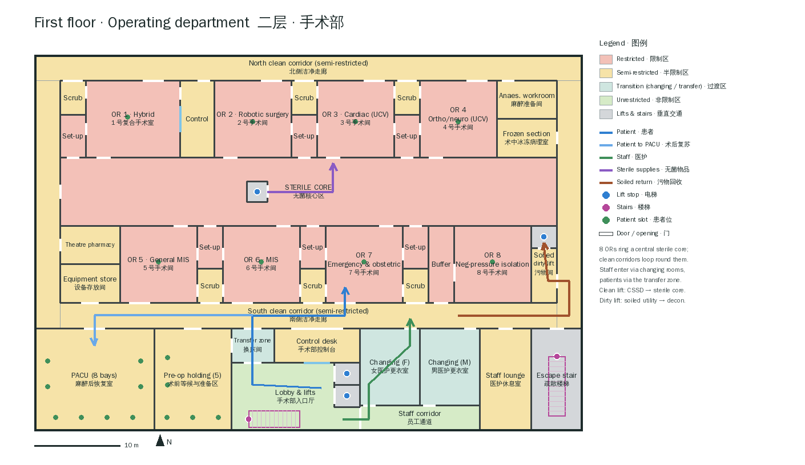
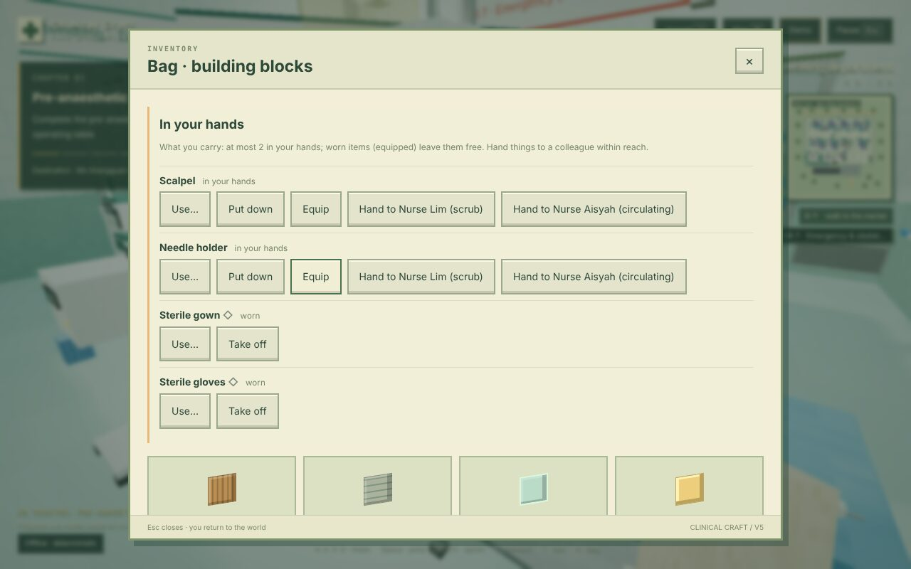
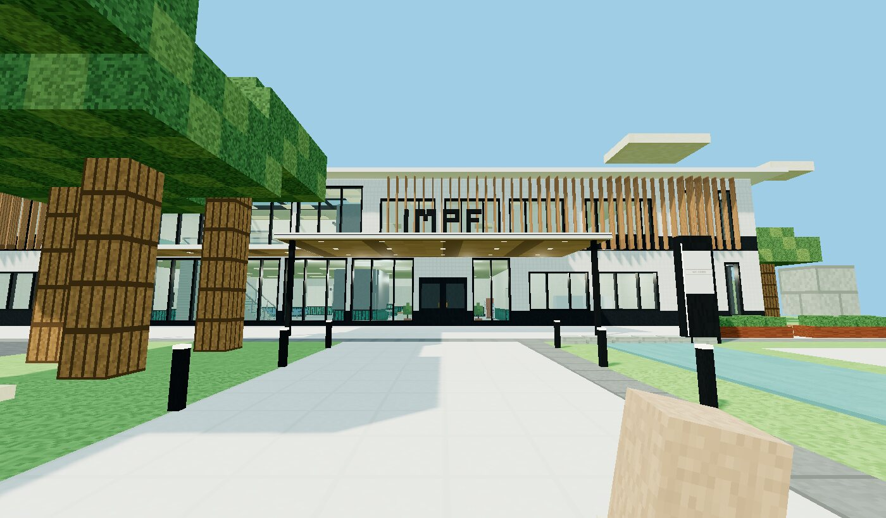

# SurgeryCraft

SurgeryCraft builds surgical training content on the
[ClinicalCraft](https://github.com/psknlr/ClinicalCraft) engine (the engine is archived here as
`ClinicalCraft-main (1).zip`). This repository is a ClinicalCraft **content pack**: plain JSON
that ClinicalCraft loads through its `contentDirs` setting, plus declarative skills. It needs a
ClinicalCraft with the hands round ([psknlr/ClinicalCraft#7](https://github.com/psknlr/ClinicalCraft/pull/7)): hand-over, worn items, `nearbyState`
and "pass me …" — and with window frame and mullion materials
([psknlr/ClinicalCraft#8](https://github.com/psknlr/ClinicalCraft/pull/8)) for the exterior. The equipment models need a ClinicalCraft that serves a content
pack's own `assets/` and keeps screens live over models (the Blender round, ClinicalCraft
docs/BLENDER.md); with an older one they are not found and the voxel parts are drawn.

## IMPF Surgery Hospital · IMPF 外科医院



**IMPF Surgery Hospital** (`impf-surgery-hospital`) is a two-storey hospital whose first
floor is a full operating department, designed to the strictest of the Singaporean, European,
US and Japanese requirements for each topic ([docs/STANDARDS.md](docs/STANDARDS.md)):

* 8 ORs round a central sterile core: a **hybrid OR** with robotic angiography and its control
  room, a **robotic surgery** OR, two **Class I ultra-clean** laminar-flow ORs (cardiac &
  transplant, arthroplasty & neuro), three **integrated digital** ORs (one held 24/7 for
  emergency and obstetric surgery) and a **negative-pressure isolation** OR behind an
  interlocked anteroom;
* restricted / semi-restricted / unrestricted zoning enforced by access zones, one-way staff
  changing rooms, a patient transfer zone with a red line, scrub bays and sterile set-up rooms
  between the ORs, an 8-bay PACU and 5-bay pre-op holding;
* clean and dirty lifts to the ground-floor CSSD, which runs one way from decontamination to
  the sterile store; plus admissions, day surgery, the perioperative lab, blood bank and a
  surgical skills & simulation centre;
* **interactive people, instruments and devices**: an OR team in every OR who pass what you
  call for ("Scalpel.", "把手术刀递给我"); instruments, gowns, gloves and lead aprons you pick up,
  wear and hand over, each with a lifecycle (sterile → in use → used → CSSD); the WHO
  checklist, count board with RF wand, smoke evacuator and generator, control panel,
  laparoscopy tower, lead shield, contrast injector, washer-disinfectors and sterilisers as
  state machines that gate each other ([docs/INTERACTIONS.md](docs/INTERACTIONS.md));
* **real 3D equipment**: the anaesthesia workstation, pendants, laparoscopy tower, hybrid table,
  back table, Mayo stand and the instruments on it, and 11 more types, drawn as models built
  in Blender from their voxel parts. Screens stay live and interactions are unchanged
  ([docs/MODELS.md](docs/MODELS.md)).




The exterior is a white rainscreen volume with ribbon glazing. The entrance is a double-height
glass lantern under a floating canopy that carries the IMPF letters, and timber-look fins screen
the operating floor. Outside there is a granite arrival plaza with a reflecting pool and a tree
bosque. On the roof sit a helipad, photovoltaics, a plant screen and staff gardens. See
[docs/EXTERIOR.md](docs/EXTERIOR.md).



Design specification, room schedule and screenshots:
**[docs/SURGICAL_FLOOR.md](docs/SURGICAL_FLOOR.md)** · standards matrix:
**[docs/STANDARDS.md](docs/STANDARDS.md)** · interactions:
**[docs/INTERACTIONS.md](docs/INTERACTIONS.md)**.

## Layout

```
content/
  catalogs/surgerycraft-or.json      62 equipment types (19 with behaviours), 21 materials (bilingual)
  templates/sc-*.json                15 room templates (ORs, scrub, set-up, PACU, pre-op, changing, …)
  facilities/impf-surgery-hospital.json   IMPF Surgery Hospital
  assets/models/sc-*.glb             19 equipment models (Blender; MIT), served at /local-assets/models/
.clinicalcraft/skills/impf-*.json    3 workflow skills (time-out, closing counts, CSSD cycle)
docs/SURGICAL_FLOOR.md               design specification · docs/img/ figures
docs/STANDARDS.md                    SG / EU / US / JP standards matrix and the targets chosen
docs/INTERACTIONS.md                 people, instruments and devices: lifecycles, gates, skills, words
docs/EXTERIOR.md                     the exterior: envelope, arrival, landscape, roof
docs/MODELS.md                       the equipment models: how they are built, licensed and checked
tools/check.sh                       validate the pack and run the tests below against ClinicalCraft
tools/navcheck.test.ts               navigation & zoning (run by check.sh)
tools/orflow.test.ts                 the OR workflows on the world runtime (run by check.sh)
tools/skills.test.ts                 the skills and "pass me" in a session (run by check.sh)
tools/content-gen/                   Python generator that writes content/ (python3 build.py; exterior.py: the exterior)
tools/blender/                       Blender builds of the models (build.py, models.py, models.json, preview.py)
.mcp.json                            blender-mcp for Claude Code (telemetry off)
dataset/                             150 CMCR surgical case-report archives (zip; source material)
```

## Use it with ClinicalCraft

This repository is a ClinicalCraft project: its `.clinicalcraft/settings.json` adds the pack
(`contentDirs`) and `.clinicalcraft/skills/` holds the skills. From a ClinicalCraft checkout next
to it, run commands with `--cwd ../SurgeryCraft`; trust the project once so its skills load:

```bash
npm run cc -- trust --cwd ../SurgeryCraft
```

```bash
npm run cc -- serve --cwd ../SurgeryCraft
```

Or point ClinicalCraft at the pack alone, e.g. in `ClinicalCraft/.clinicalcraft/settings.local.json`
(git-ignored; a relative path resolves against the settings file's folder):

```json
{ "contentDirs": ["../../SurgeryCraft/content"] }
```

Then, from the ClinicalCraft checkout:

```bash
npm run cc -- facilities validate --all
```

```bash
npm run cc -- facilities compile impf-surgery-hospital
```

```bash
npm run cc -- serve
```

`serve` offers the pack to the web world (choose *IMPF Surgery Hospital*). An
operating-room case such as `cmcr-1653406` starts in OR 7.

## Check and regenerate

```bash
tools/check.sh ../ClinicalCraft
```

```bash
python3 tools/content-gen/build.py
```

The generator reads ClinicalCraft's built-in catalogs from `../ClinicalCraft` (or
`$CLINICALCRAFT_DIR`) for footprint checks and rewrites `content/` byte-for-byte, with the
model references from `tools/blender/models.json`. To rebuild the models first (Blender 4.1+,
or a Python 3.11 with the `bpy` module; [docs/MODELS.md](docs/MODELS.md)):

```bash
blender -b -P tools/blender/build.py
```
