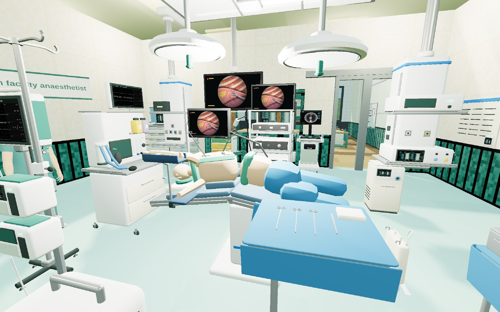
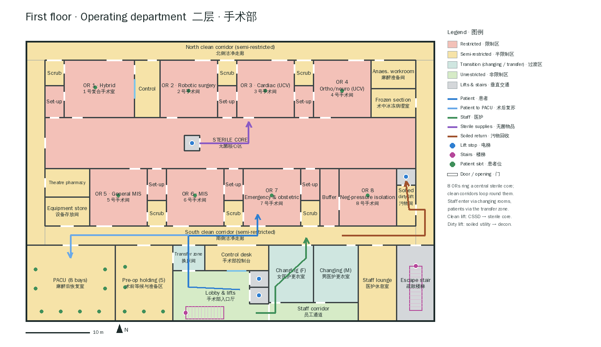
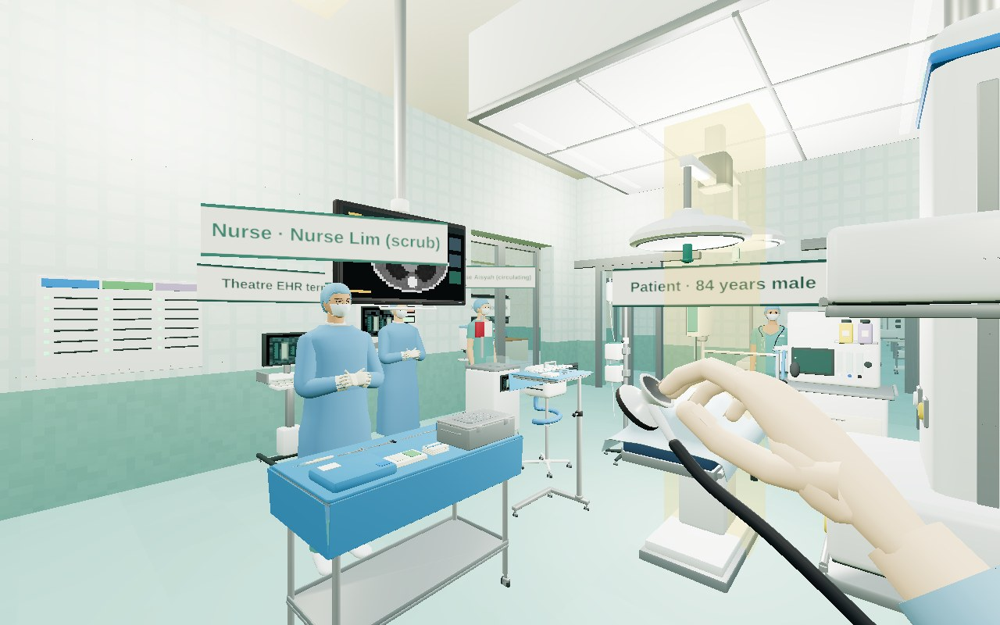
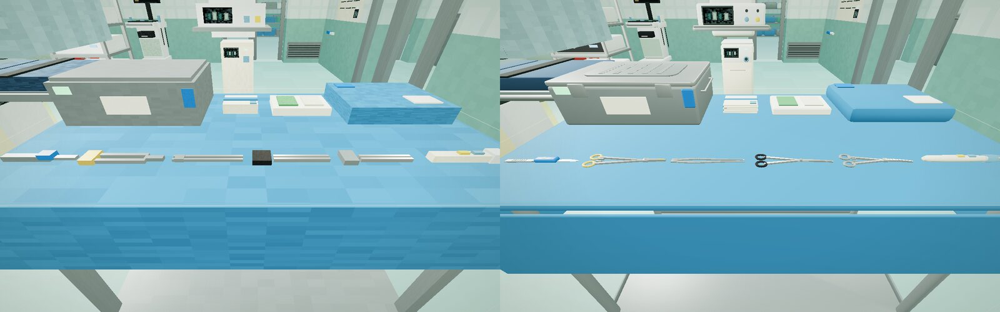
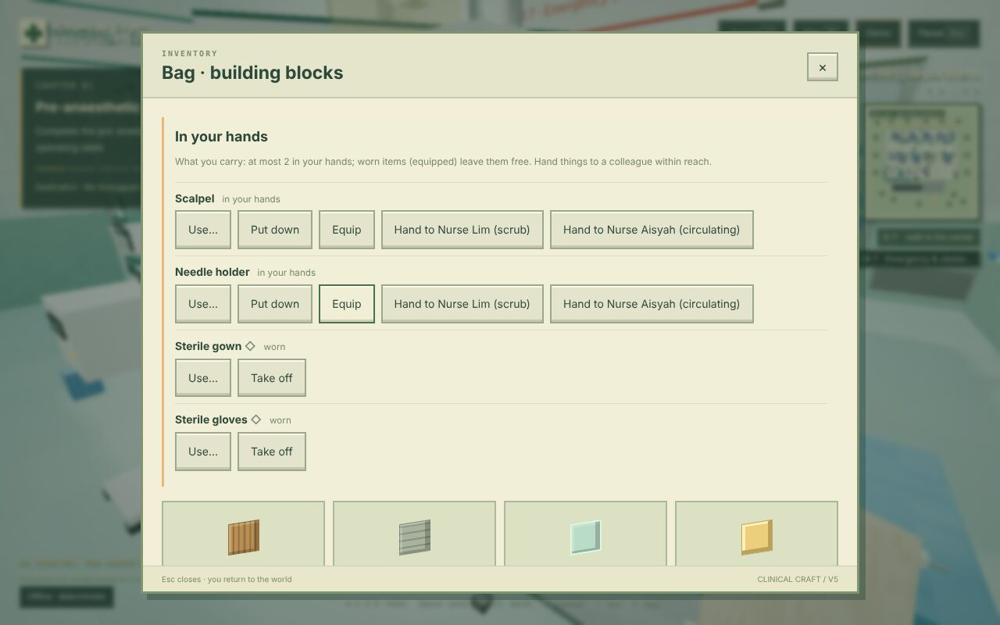
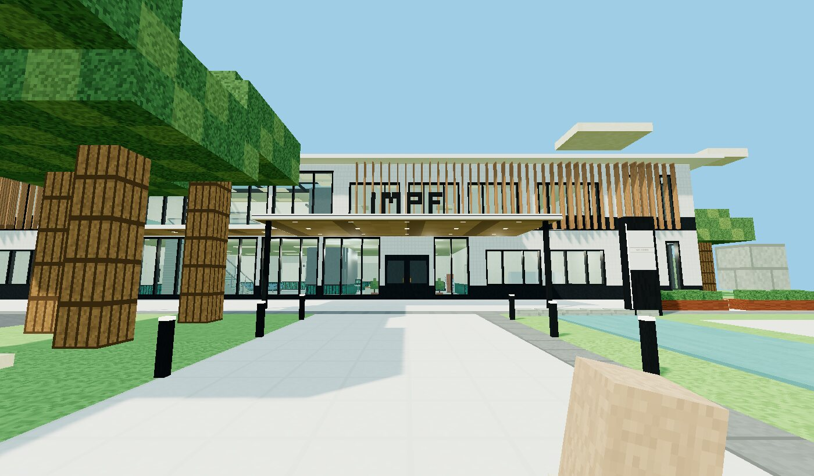

# SurgeryCraft

## Case 126 v4 · 全内脏反位腹腔镜胆囊切除术（可操作）

**Case 126 (`cmcr-1654623`) is now a case you operate.** It is in the content pack
(`content/cases/cmcr-1654623`) and runs as one session in the IMPF Surgery Hospital:

- history, examination and records;
- a diagnosis framed by the Tokyo Guidelines 2018;
- perioperative risk (age 84, COPD, previous stroke);
- the WHO checklist;
- the laparoscopic cholecystectomy itself: ports, traction, dissection, the critical view of safety
  judged on the field, clips, division, bail-outs and complications that follow from what you do;
- recovery, then the report's own course.

One rubric and one set of safety gates score it all. **2.3.0** repairs what an audit of a 2.1.0 save found:
the monitor is its own task and the WHO Sign In waits for its checks; an anaesthesia hold is recorded (who, why,
who released it); the agent is told what is still needed and that the operation is done on the field, never with
a count or a device; colleagues correct unsafe induction, extubation and laterality teaching; and one end-to-end
acceptance run (history to recovery handover, with a reload before the board's Time Out) keeps the record, the
WHO board and the score in agreement. See [docs/CASE_126.md](docs/CASE_126.md) for
what is implemented, its sources and the validation still owed.

**Anatomical variants and an operative benchmark.** The case has five counterfactual anatomies, each
labelled authored, never the default:

- a double cystic artery;
- a caterpillar hump of the right hepatic artery;
- an aberrant right posterior duct;
- a frozen triangle;
- a subvesical duct.

A session can be started in any of them, and the variant stays hidden from the operator. The suite
`content/operative/case126-v1` (8 scenarios, dev and held-out test) runs agents with
`clinicalcraft bench operative`, with the anatomy hidden. Each anatomy has an expert trajectory that
scores 100 %. The reported anatomy's routine, replayed blind, is safety-critical in every variant.

The anatomy is case-informed **reference** anatomy, not a CT reconstruction:

- BodyParts3D organ surfaces, mirrored;
- the Layered Human (MIT) hepatobiliary tree, mirrored once and registered.

Intra-operative vital signs are simulated. The case is **not clinician-reviewed**. The v3
demonstration and its editable Blender handoff stay in
**[dataset/case-126-v3](dataset/case-126-v3/README.md)** as the historical baseline.

SurgeryCraft builds surgical training content on the
[ClinicalCraft](https://github.com/psknlr/ClinicalCraft) engine (the engine is archived here as
`ClinicalCraft-main (1).zip`). This repository is a ClinicalCraft **content pack**: plain JSON
that ClinicalCraft loads through its `contentDirs` setting, plus declarative skills. It needs a
ClinicalCraft with the hands round ([psknlr/ClinicalCraft#7](https://github.com/psknlr/ClinicalCraft/pull/7)): hand-over, worn items, `nearbyState`
and "pass me …" — and with window frame and mullion materials
([psknlr/ClinicalCraft#8](https://github.com/psknlr/ClinicalCraft/pull/8)) for the exterior. The equipment models need a ClinicalCraft that serves a content
pack's own `assets/` and keeps screens live over models (the Blender round,
[psknlr/ClinicalCraft#10](https://github.com/psknlr/ClinicalCraft/pull/10)), and one that ships
the built-in types' models for the rest (the models round); with an older one those are not
found and the voxel parts are drawn. Case 126 needs a ClinicalCraft with the operative field
([psknlr/ClinicalCraft#13](https://github.com/psknlr/ClinicalCraft/pull/13)). Its variants and
operative suite also need procedure variants and `bench operative` (the variants round), and Case 126
2.3.0 needs ClinicalCraft's audit round (explicit holds, `clock.worldTime`, `npcs[].corrections`, the
requirements in `case_status`, the board's prerequisites on `intervene`). The ISO 32 gas colours and the rebuilt
models (the robot, the angiography C-arm, the heart-lung machine…) need the ClinicalCraft pinned in
`tools/clinicalcraft.rev`: the palette's `gas-oxygen` and the shape kit's `pipe`, `hose` and `revolve`.
Thoracoscopy needs the `thoracoscopy` screen ([psknlr/ClinicalCraft#25](https://github.com/psknlr/ClinicalCraft/pull/25))
and, for the training station's patient simulator, an equipment type's `manikin` — a body the world draws
with its own figures ([psknlr/ClinicalCraft#26](https://github.com/psknlr/ClinicalCraft/pull/26)).

## Thoracoscopy · 胸腔镜手术

**OR 5 is the thoracic theatre**, set up for thoracoscopic (VATS) lung surgery, and the
simulation OR holds a **thoracoscopy training station**:

- a thoracoscopy tower and two endoscopy displays that show the picture a thoracoscope gives;
- nine instruments on their own sterile table — 30° thoracoscope, port, lung forceps,
  right-angle dissector, clip applier, ultrasonic shears, cutter-stapler, specimen bag, chest
  tube;
- lung isolation (double-lumen tubes, bronchoscope), the aids for the lateral position, a chest
  drainage unit;
- their rules as data: the tube confirmed before the patient is turned and again after, no port
  before the lung is down, no picture before the white balance, energy with smoke evacuation,
  the drain primed and connected before the lung is re-expanded;
- on the training station, the seventeen steps of a thoracoscopic lobectomy in order, each with
  its instrument in the hand — on a patient simulator that is one of the world's own figures (the
  proportions, the face and the hands of the people of the world), lying on its side, the
  station's supports built round it; what is drawn of it follows each step, whoever takes it —
  under a blanket, then draped and on one lung, the ports, the scope, the drain and the dressings
  coming and going, the monitor on while the scope is in.

It has no thoracoscopic clinical case yet, and it is not clinician-reviewed. See
**[docs/THORACOSCOPY.md](docs/THORACOSCOPY.md)**; what public surgical video datasets exist and
under which terms: **[docs/DATASETS.md](docs/DATASETS.md)**.



## IMPF Surgery Hospital · IMPF 外科医院



**IMPF Surgery Hospital** (`impf-surgery-hospital`) is a two-storey hospital whose first
floor is a full operating department, designed to the strictest of the Singaporean, European,
US and Japanese requirements for each topic ([docs/STANDARDS.md](docs/STANDARDS.md)):

* 8 ORs round a central sterile core: a **hybrid OR** with robotic angiography and its control
  room, a **robotic surgery** OR, two **Class I ultra-clean** laminar-flow ORs (cardiac &
  transplant, arthroplasty & neuro), a **thoracoscopic** OR, two **integrated digital** ORs
  (one held 24/7 for emergency and obstetric surgery) and a **negative-pressure isolation** OR
  behind an interlocked anteroom;
* restricted / semi-restricted / unrestricted zoning enforced by access zones, one-way staff
  changing rooms, a patient transfer zone with a red line, scrub bays and sterile set-up rooms
  between the ORs, an 8-bay PACU and 5-bay pre-op holding;
* clean and dirty lifts to the ground-floor CSSD, which runs one way from decontamination to
  the sterile store; plus admissions, day surgery, the perioperative lab, blood bank and a
  surgical skills & simulation centre;
* **interactive people, instruments and devices**: an OR team in every OR who pass what you
  call for ("Scalpel.", "把手术刀递给我") and are dressed for their position — the scrub nurse
  in cap, mask, sterile gown and gloves with one hand held over the other in front, the circulating nurse
  and the anaesthetist in theatre scrubs, cap and mask (ClinicalCraft draws a `position`'s
  attire; nobody stands in theatre in a white coat); instruments, gowns, gloves and lead aprons you pick up,
  wear and hand over, each with a lifecycle (sterile → in use → used → CSSD); the WHO
  checklist, count board with RF wand, smoke evacuator and generator, control panel,
  laparoscopy tower, lead shield, contrast injector, washer-disinfectors and sterilisers as
  state machines that gate each other ([docs/INTERACTIONS.md](docs/INTERACTIONS.md));
* **real 3D equipment everywhere**: every piece of equipment in the hospital (918 placements: the
  pack's 90 types and ClinicalCraft's built-in ones) is drawn as a model built in Blender from
  its voxel parts: the instruments, anaesthesia workstation, pendants and surgical lights,
  robotic system, PACU beds, sterilisers, the exterior. Screens stay live and interactions are
  unchanged ([docs/MODELS.md](docs/MODELS.md)).







The exterior is a white rainscreen volume with ribbon glazing. The entrance is a double-height
glass lantern under a floating canopy that carries the IMPF letters, and timber-look fins screen
the operating floor. Outside there is a granite arrival plaza with a reflecting pool and a tree
bosque. On the roof sit a helipad, photovoltaics, a plant screen and staff gardens. See
[docs/EXTERIOR.md](docs/EXTERIOR.md).



Design specification, room schedule and screenshots:
**[docs/SURGICAL_FLOOR.md](docs/SURGICAL_FLOOR.md)** · standards matrix:
**[docs/STANDARDS.md](docs/STANDARDS.md)** · interactions:
**[docs/INTERACTIONS.md](docs/INTERACTIONS.md)**.

## Layout

```
content/
  catalogs/surgerycraft-or.json      90 equipment types (33 with behaviours), 37 materials (bilingual)
  templates/sc-*.json                16 room templates (ORs, scrub, set-up, PACU, pre-op, changing, …)
  facilities/impf-surgery-hospital.json   IMPF Surgery Hospital
  assets/models/sc-*.glb             90 equipment models (Blender; MIT), served at /local-assets/models/
.clinicalcraft/skills/impf-*.json    4 workflow skills (time-out, closing counts, CSSD cycle, thoracoscopy set-up)
docs/SURGICAL_FLOOR.md               design specification · docs/img/ figures
docs/STANDARDS.md                    SG / EU / US / JP standards matrix and the targets chosen
docs/INTERACTIONS.md                 people, instruments and devices: lifecycles, gates, skills, words
docs/EXTERIOR.md                     the exterior: envelope, arrival, landscape, roof
docs/MODELS.md                       the equipment models: how they are built, licensed and checked
docs/THORACOSCOPY.md                 thoracoscopy: the thoracic theatre, its instruments and rules, the training station
docs/DATASETS.md                     public surgical video datasets: what they are, their licences, what the pack uses
tools/check.sh                       validate the pack and run the tests below against ClinicalCraft
tools/navcheck.test.ts               navigation & zoning (run by check.sh)
tools/orflow.test.ts                 the OR workflows on the world runtime (run by check.sh)
tools/thoracoscopy.test.ts           thoracoscopy in OR 5 and on the training station (run by check.sh)
tools/skills.test.ts                 the skills and "pass me" in a session (run by check.sh)
tools/content-gen/                   Python generator that writes content/ (python3 build.py; exterior.py: the exterior; thoracoscopy.py)
tools/blender/                       Blender builds of the models (build.py, models.py, thoracic_models.py, models.json, preview.py)
tools/figure-fit.mts                 where the training station's body is, from the pinned ClinicalCraft's figure kit → tools/blender/fit/ (check.sh: --check)
.mcp.json                            blender-mcp for Claude Code (telemetry off)
dataset/                             150 CMCR surgical case-report archives (zip; source material)
```

## Use it with ClinicalCraft

This repository is a ClinicalCraft project: its `.clinicalcraft/settings.json` adds the pack
(`contentDirs`) and `.clinicalcraft/skills/` holds the skills. From a ClinicalCraft checkout next
to it, run commands with `--cwd ../SurgeryCraft`; trust the project once so its skills load:

```bash
npm run cc -- trust --cwd ../SurgeryCraft
```

```bash
npm run cc -- serve --cwd ../SurgeryCraft
```

Or point ClinicalCraft at the pack alone, e.g. in `ClinicalCraft/.clinicalcraft/settings.local.json`
(git-ignored; a relative path resolves against the settings file's folder):

```json
{ "contentDirs": ["../../SurgeryCraft/content"] }
```

Then, from the ClinicalCraft checkout:

```bash
npm run cc -- facilities validate --all
```

```bash
npm run cc -- facilities compile impf-surgery-hospital
```

```bash
npm run cc -- serve
```

`serve` offers the pack to the web world (choose *IMPF Surgery Hospital*). An
operating-room case such as `cmcr-1653406` starts in OR 7.

## Check and regenerate

```bash
tools/check.sh ../ClinicalCraft
```

```bash
python3 tools/content-gen/build.py
```

The generator reads ClinicalCraft's built-in catalogs from `../ClinicalCraft` (or
`$CLINICALCRAFT_DIR`) for footprint checks and rewrites `content/` byte-for-byte, with the
model references from `tools/blender/models.json`. To rebuild the models first (Blender 4.1+,
or a Python 3.11 with the `bpy` module; [docs/MODELS.md](docs/MODELS.md)):

```bash
blender -b -P tools/blender/build.py
```
