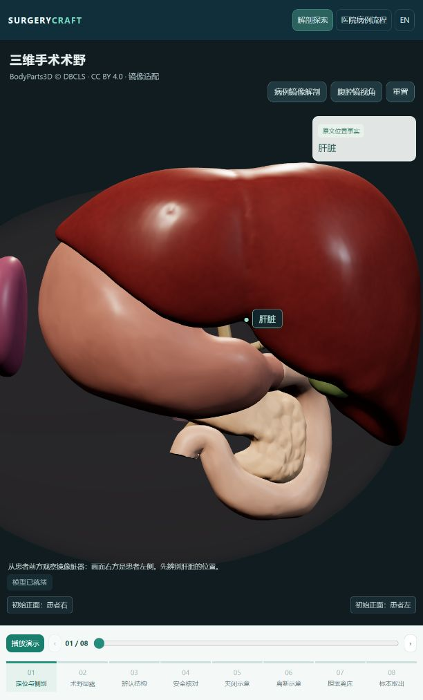

# 病例126 · 三维手术样例 v3

内脏完全反位腹腔镜胆囊切除术教学样例。此版本保留精修后的肝胆形态、腹腔三维术野、八阶段操作动画，以及同一入口内的医院病例流程。

## 查看与交接

| 文件 | 用途 |
| --- | --- |
| [index.html](index.html) | 单文件演示，约25 MB；下载后用桌面 Chrome 或 Edge 打开 |
| [SurgeryCraft_病例126_三维手术样例_v3.zip](SurgeryCraft_病例126_三维手术样例_v3.zip) | 完整交接包，含同版 HTML、Blender 工程、GLB、网页源码、病例材料、验证记录及许可 |
| [preview.png](preview.png) / [laparoscopic-view.png](laparoscopic-view.png) | 肝脏外观和肝下术野的实测截图 |
| [manifest.json](manifest.json) / [SHA256SUMS.txt](SHA256SUMS.txt) | 版本、文件大小与完整性校验 |
| [validation.json](validation.json) | 此版演示的验证结果 |
| [LICENSE.txt](LICENSE.txt) / [third-party-licenses](third-party-licenses) | 原创代码、参考器官网格和依赖的许可 |

**只体验：** 下载 `index.html` 即可。GitHub 文件页显示源码或下载入口，不会直接运行这个网页；使用文件页的下载按钮保存，或下载 ZIP 后解压其中的 HTML。运行需要支持 WebGL 的桌面浏览器，无需安装 Blender、Node.js 或输入 API 密钥。

**继续开发：** 下载完整 ZIP。解压后阅读 `先读我.txt` 和 `使用与开发说明.md`；Blender 工程位于 `source/content/assets/blender/`，网页代码位于 `source/surgical-view/`，生成代码位于 `source/tools/blender/`。ZIP 包含制作此演示时的医院内容快照，建议解压至独立开发目录，按需将病例改动合入当前医院项目。构建依赖的 ClinicalCraft 引擎及环境要求见包内说明。

## 操作

1. 拖动旋转，滚轮缩放，点选器官；可切换腹腔镜视角、显隐结构及调整肝脏透明度。
2. 点击“播放演示”。第四阶段会暂停，完成两个学习勾选后再播放，继续查看夹闭、离断、离床和取出。
3. 顶部“医院病例流程”进入医院；搜索 `84`，选择病例与 IMPF 外科医院。

## 来源、范围与验证

器官表面采用 BodyParts3D / DBCLS 参考解剖网格，经 Blender 镜像、平滑及材质调整；胆道、器械和操作轨迹为教学设计。模型不是患者 CT 分割重建，未模拟真实组织切割；解剖操作尚未计入医院病例评分，尚未经临床专家审核。

BodyParts3D, © The Database Center for Life Science licensed under CC Attribution 4.0 International。改编器官网格沿用 CC BY 4.0；原创代码和示意结构采用 MIT。完整来源及修改说明见许可文件与 ZIP 内 `source/content/assets/source/bodyparts3d/sources.json`。

病例来源：张少博、余仁斌，《内脏完全反位腹腔镜胆囊切除术一例》，肝胆胰外科杂志，2024，36(3)：180–181。交接包包含改编病例和证据索引，未附原始 PDF 或医学图片。仓库既有病例数据压缩包保持原状。

本版通过 8 项状态测试、GLB/HTML 嵌入一致性检查、Blender 关键帧检查和浏览器交互检查。浏览器实测使用本地 HTTP；双击文件的 `file://` 方式未在受控浏览器中实测，离线资源由静态检查核验。先前病例参考流程的100分是脚本验证结果，不是大模型评测成绩。

## English

Case 126 v3 is a self-contained anatomy and hospital-workflow teaching demo. Download `index.html` to view, or the ZIP to edit the Blender project and source. The adapted reference organs are not patient-derived anatomy. Clinical review and integration of anatomy events into clinical scoring remain future work. Original code/schematic additions: MIT; BodyParts3D organ surfaces: CC BY 4.0.
