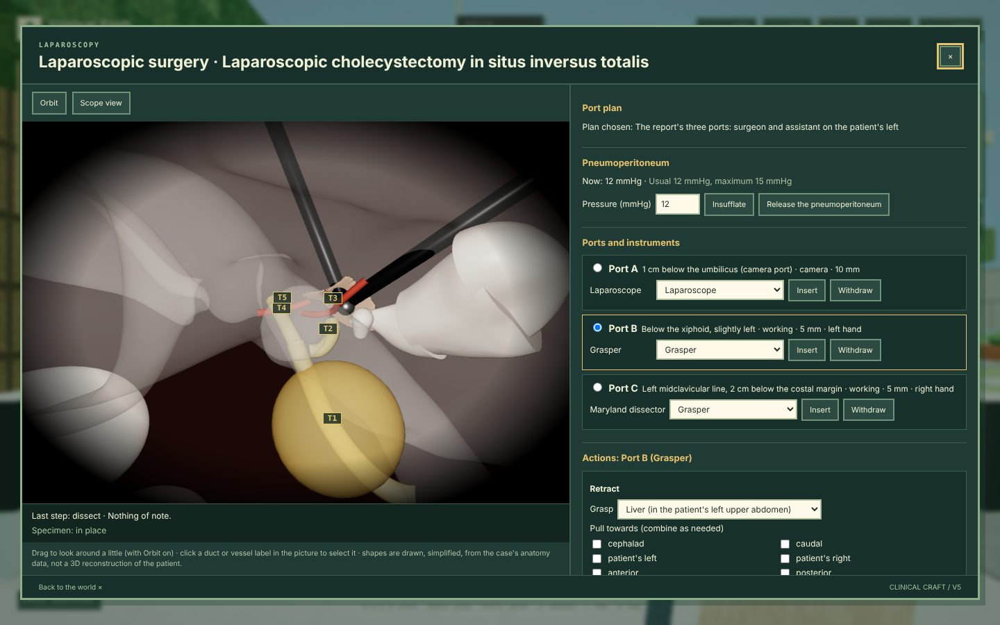

# Case 126 v4: laparoscopic cholecystectomy in situs inversus totalis

**Case id:** `cmcr-1654623`

**Source:** 张少博, 余仁斌. 内脏完全反位腹腔镜胆囊切除术一例. 肝胆胰外科杂志 2024;36(3):180–181. The PDF is in
`dataset/126_1654623_…zip`; it is not copied into the content pack.

**Status:** editorial review only. Reference anatomy, synthetic intra-operative physiology, not clinician-reviewed.

v4 turns Case 126 from an animated demonstration into a case the learner or an agent **operates**. The
whole encounter is one session:

- history, examination and records;
- diagnosis, laterality and planning;
- perioperative risk;
- the WHO checklist;
- the operation;
- recovery;
- the review of what the report actually describes.

The operation uses ClinicalCraft's operative-field model (`docs/PROCEDURE.md` in ClinicalCraft). The
critical view of safety is judged on the field, not by ticking boxes. Injuries follow from what was
actually clipped, divided or burnt. One rubric and one set of safety gates score the clinical reasoning
and the operation together.

The v3 demonstration (`dataset/case-126-v3/`) is kept unchanged as the historical reference and
regression baseline. Its eight-stage animation remains a teaching resource there.



The window runs in ClinicalCraft under `clinicalcraft serve` with this pack, in OR 7 of the IMPF
hospital. The screenshot shows the reference path after the triangle has been dissected.

## Files

| file | what |
|---|---|
| `content/cases/cmcr-1654623/case.json` | the case, generated by `tools/case-gen/build_case_1654623.py` (v4) on top of `case_1654623_base.py` (the v3 authored base, unchanged) |
| `content/cases/cmcr-1654623/evidence.json` | evidence ledger (`surgerycraft/evidence-ledger@2`): every history, exam and record item and every patient-specific value, with provenance `published-case`, `unknown` or a labelled `simulationOverride` (synthetic, requires clinical review) |
| `content/cases/cmcr-1654623/README.md` | the facilitator guide |
| `content/assets/cases/cmcr-1654623/anatomy.glb` | the reference anatomy model; node names are the procedure's structure ids |
| `content/assets/cases/cmcr-1654623/anatomy.json` | centrelines, regions and port sites in the patient frame (+x the patient's left, +y cranial, +z anterior, metres); read by the case generator |
| `content/assets/cases/cmcr-1654623/asset-provenance.json`, `LICENSES.md` | sources, licences, transforms, hashes; `clinicianReviewed: false`, `patientSpecific: false` |
| `tools/blender/build_anatomy_1654623.py`, `verify_anatomy_1654623.py` | rebuilds the model; checks laterality, topology and port reach |
| `tools/case126.test.ts` | the case's fidelity, safety and variant scenarios (run by `tools/check.sh` inside a ClinicalCraft checkout) |
| `tools/case126-studies.test.ts`, `tools/case126-release.test.ts` | investigations beyond the published case (and the second run's perturbations); the first release scenario — the assistant's traction, the anaesthetist's relief, a save and resume midway (both run by `tools/check.sh`) |
| `tools/browser-demos.mjs` | the four browser demonstrations of the web build (2.4.0's three and 2.5.0's release scenario) |
| `content/operative/case126-v1/*.json` | the operative benchmark suite, generated by `tools/operative/build_suite_case126.py` |

## How the brief maps to v4

| brief | v4 | where |
|---|---|---|
| §3 source of truth, provenance of every fact | facts kept as published; every item in the ledger; synthetic values only as labelled `simulationOverride`; physiology messages say "simulated value" | `evidence.json`, `case.json` physiology, test "labels every simulated value" |
| §3.1 diagnostic correction | decision `diagnosis`: gallstone disease with *suspected*, not confirmed, acute cholecystitis (Tokyo Guidelines 2018). Fever by history but 36.6 °C at examination, Murphy negative, labs summarised as normal, imaging without inflammatory signs | `decisions[diagnosis]`, rubric `r-diagnosis` |
| §4 situs inversus anatomy, coordinates | patient frame +x = the patient's left throughout (model, procedure, engine); tests on laterality and on the duct and artery tree | `anatomy.json`, `case126.test.ts` |
| §4.2 expanded structures | gallbladder (and parts where modelled), cystic plate, cystic duct and artery, common hepatic and common bile duct, right and left hepatic ducts, common, proper, right and left hepatic arteries, gastroduodenal artery, portal vein, liver, stomach, duodenum, pancreas and spleen, each with an id, kind, topology and provenance | `anatomy.json`, `procedure.anatomy` |
| §5 imaging reconstruction | no DICOM exists for this patient: **case-informed reference anatomy, not a patient-specific CT reconstruction** (stated in the disclaimer, procedure note, asset provenance and README) | §Anatomy below |
| §6 preoperative workflow | history, examination, records (unrecorded ones answer "not recorded"), a diagnosis decision; nothing reveals the diagnosis | phase `assessment` |
| §7 elderly perioperative risk | unrecorded items kept unknown (antithrombotics, COPD status, stroke deficits, ECG, lung function); decision `risk` (rejects assigning an ASA class from the record); anaesthetist; synthetic pneumoperitoneum and COPD physiology, labelled; dextrocardia handled in the Sign In (mirror lead and pad positions) | phases `preop`, `theatre` |
| §8 operating room, WHO checklist | attaching the monitor is its own task (`attach-monitor`); the Sign In is valid only after its checks (monitor on, allergies and fasting asked) and before induction; a valid Time Out (after a valid Sign In and induction) opens the operation, Sign Out after closing; the steps are checklist steps: an out-of-order attempt is logged as invalid (and said so on every path), leaves the operation locked and can be repeated in order; the order is scored by committed sequence and a reversed induction shows in the verdict (gate `induction-before-sign-in`); OR 7's WHO board shows the case record and its operations are the case's own steps, with the same team prerequisites whichever way a step is taken; an explicit anaesthesia hold refuses induction until its holder records a reassessment; the operation is done only at the table (the operator and the patient checked again after an approval wait) | interventions `attach-monitor`, `sign-in`, `induction`, `time-out`, `sign-out`; `tools/case126-theatre.test.ts`, `tools/case126-acceptance.test.ts` |
| §9 ergonomics, configurable ports | three plans: the report's three ports (surgeon on the left, hands cross, as reported), a mirrored four-port plan, and the habitual right-sided plan (its shafts fence). Port metrics include reach, manipulation angle, crossing and in-line warnings; trocar-pivot reach and shaft clashes are enforced | `procedure.portPlans`, `portReport` |
| §10 interactive surgery | every step is an `operate` action: insert or withdraw instruments, retract (named directions in patient terms), dissect (with or without energy), isolate, identify, clip, divide, coagulate, suction, irrigate, cholangiography, inspect, recognise, bag, extract, bail out, close. Impossible steps are refused; unsafe ones are carried out and recorded | ClinicalCraft `docs/PROCEDURE.md` §3 |
| §11 critical view of safety | three criteria evaluated on the field: triangle cleared, lower third off the cystic plate, and the structures entering the gallbladder (a common bile duct tented by habitual traction appears to enter). For the last one the operator reports how many structures they see (usually two); only the true number is credited, so with a second cystic artery the right report is three. The safety pause records claims against the field; ticking is never verification. The counting criterion needs review by hepatobiliary surgeons | `procedure.views[cvs]`, rubric `r-cvs` |
| §11.3 safe alternatives | call for help, cholangiography, subtotal cholecystectomy (fenestrating or reconstituting), conversion; all accepted and scored as legitimate | `procedure.bailouts` |
| §12 complications | bile duct injury (clipped: occlusion, seen on imaging; divided: bile in the field), vascular injury, cystic artery bleeding (field obscured until suction, then control), stump leak, perforation with bile and stone spillage, thermal injury from energy near hidden structures, pneumoperitoneum hypercapnia (synthetic). None occurs on a sound operation | ClinicalCraft `docs/PROCEDURE.md` §5 |
| §13–14 decision-making, state machine | phases gated by conditions (assessment → preop → theatre → operation → recovery → review); multiple defensible strategies accepted (two port plans, completion or bail-out) | `phases`, `objectives` |
| §15 postoperative | recovery handover, decision `postop`; then the report's own course (histology chronic cholecystitis and gallstones, discharge on day 5, well at one month), opened only after the simulation | phases `recovery`, `review` |
| §16 unified scoring | 33 rubric items in the brief's seven domains (15/10/15/30/15/10/5), including closure credited from the field (`r-closed`) and extubation decided apart from oral intake (`r-emergence`). The operation's outcome items are scored from the moment a valid Time Out opens it, so a run that never operates loses them. Complication items are scored only when a complication occurs; the percentage then renormalises over the scored items | rubric, `extensions.version4.scoringDomains` |
| §16.2 safety override | safety gates: bile duct injury, vascular injury, misidentification and thermal injury cap the score at 40 %; an irreversible step without a true view, an unrecognised injury and carrying on after a visible injury cap it at 50 %. Perforation, bleeding and stump leak are complications | `safetyGates` |
| §16.3 GOALS | not claimed. Clashes and instrument exchanges are counted; there is no validated GOALS implementation | — |
| §17 AI agents | the same session tools for agents and learners. `observe_field` shows only what a surgeon could see (handles, not duct names); `operate` acts. Hidden truth, unsafe-act records and scores reach only the debrief; full traces through ClinicalCraft's transcripts | ClinicalCraft `docs/PROCEDURE.md` §7 |
| §19 architecture | the canonical content pack (`content/cases`, `content/assets/cases`); loadable through `contentDirs` like every SurgeryCraft case; the v3 dataset untouched | — |
| §21 automated tests | engine adversarial suite (ClinicalCraft `procedure.test.ts`); case scenarios (`tools/case126.test.ts`); anatomy verification; `cases validate --strict` and `cases verify` | `tools/check.sh` |

## Anatomy

The anatomy combines two sources, chosen after reviewing the open sources suggested for this case.

**BodyParts3D organ surfaces.** © DBCLS, CC BY 4.0. These are the v3 surfaces: liver, gallbladder,
stomach, duodenum and pancreas, already mirrored for situs inversus.

**Layered Human (AnatomyExplorer) procedural hepatobiliary tree.** © 2026 Ethan Prince, MIT. Its
ducts and arteries are centrelines built as one tree: the cystic artery leaves the right hepatic
artery, and the cystic duct joins the common hepatic duct where the common bile duct begins. They
are mirrored once for situs inversus and registered to the BodyParts3D gallbladder and liver. The
same centrelines drive the simulation, so what is drawn is what the engine reasons about.

Authored, MIT and labelled as authored: the spleen (no CC BY spleen was available offline), the cystic
plate patch and the port sites on the abdominal wall.

Not used:

- OrganUI gallbladder-3d: BodyParts3D 4.3, CC BY-SA 2.1 JP. Share-alike would bind the whole model.
- BodyVista: Z-Anatomy, CC BY-SA 4.0, labelled "NC exceptions; research only" and not verified. It
  also has no cystic duct or artery.
- 3D-IRCADb: CC BY-NC-ND 4.0.
- Endoscapes2023: controlled access and a data use agreement. Useful later for visual validation, not
  for redistribution.

The source report states that at operation "no vascular anatomical variation" was found. The
patient's own ductal insertion and arterial origin are not reported. The model uses a reference
configuration, mirrored, and the ledger lists it as such.

## Anatomical variants (counterfactual)

At operation the source found "no vascular anatomical variation". The base anatomy is therefore the
reference configuration. The case also carries five **variants** (`procedure.variants`; ClinicalCraft
`docs/PROCEDURE.md` §9). Each is a counterfactual anatomy, authored on the reference geometry in the
same patient frame (+x the patient's left). Each has references for the variant itself, and none is
ever the default. A session started with `{ "type": "start", "variant": id }` operates on that
anatomy. The operator is not told which anatomy it is:

- the field shows only handles and how they look;
- the list of names that can be given is the same for every variant.

The evidence ledger lists every variant under `counterfactual`, with `patientSpecific: false` and
`contradictsSource: true`.

| variant | what differs | what the field shows | the safe course | the pitfall |
|---|---|---|---|---|
| `double-cystic-artery` | a posterior cystic artery from the right hepatic artery, on the cystic plate, crossing the bed | a third structure entering the gallbladder once the plate is dissected | free it too, then a true critical view; clip and divide all three | dividing two: the view is not true (irreversible step without it), and completing the bed tears the posterior branch (bleeding) |
| `caterpillar-hump` | the right hepatic artery loops into the triangle; the cystic artery is short, from the loop | until the triangle is fully cleared, an artery that "seems to run up to the neck"; then an artery looping back to the liver | clear the triangle completely, find the short cystic artery, keep the loop | clipping the loop as the cystic artery: vascular injury |
| `aberrant-posterior-duct` | the right posterior sectoral duct crosses the triangle and joins the common hepatic duct low | until the triangle is fully cleared, a small duct that "seems to run into the back of the neck" | full clearance shows it running to the hilum; keep it | clipping or dividing it as the cystic duct: bile duct injury (Strasberg B/C) |
| `hostile-triangle` | dense fibrosis (severe chronic inflammation) | from the first dissection step, "dense, woody fibrosis"; the planes stop separating halfway (`dense-fibrosis`) | stop, call for help, then a subtotal cholecystectomy (fenestrating or reconstituting) or conversion | dissecting beyond the safe plane tears the common bile duct |
| `subvesical-duct` | a subvesical duct in the bed, draining to the right hepatic duct | a fine duct in the bed once the bed is half dissected | free it, name it, clip it twice before finishing the bed | completing the bed through it: bile leak; carrying on unrecognised is safety-critical |

Each variant has one rubric item, scored only in that variant: `r-v-double-artery`, `r-v-hump`,
`r-v-aberrant-duct`, `r-v-hostile` and `r-v-subvesical`. The base case's 100 points are unchanged.
In a variant the percentage renormalises over what is scored there. In the frozen triangle, the
identification item `r-identify` is not scored, because nothing can be freed to be identified.

The engine mechanics these variants rely on are general:

- appearance rules that read how far a region is cleared;
- a region's `fibrosis` (safe plane, finding, the structure it tears);
- a structure that `crosses` a plane.

### Measured paths (Case 126 2.3.0, `tools/case126.test.ts`)

| anatomy | expert trajectory, whole case | the reported anatomy's routine, replayed blind |
|---|---|---|
| reference | 100 % (90/90), clear | — |
| double cystic artery | 100 % (96/96), clear | 50 % (uncapped 60 %), safety-critical: irreversible step without a true view, bleeding from the posterior branch, carried on unrecognised |
| caterpillar hump | 100 % (96/96), clear | 40 % (uncapped 51 %), safety-critical: vascular injury to the right hepatic artery, misidentification |
| aberrant posterior duct | 100 % (96/96), clear | 40 % (uncapped 51 %), safety-critical: bile duct injury to the aberrant duct, misidentification |
| hostile triangle | 100 % (75/75), clear (subtotal) | 40 % (uncapped 81 %), safety-critical: common bile duct torn, carried on |
| subvesical duct | 100 % (94/94), clear | 50 % (uncapped 80 %), safety-critical: bile leak not recognised, carried on |

The blind replays stop after the operative steps, so since 2.3.0 they also miss the extubation decision; the
uncapped figures are a few points lower than in 2.1.0 for that reason alone. The uncapped figures show why the safety gates exist. A blind routine would still earn most of the
points, but it fails on safety.

## The operative benchmark (`content/operative/case126-v1`)

The suite follows ClinicalCraft's `clinicalcraft/operative-scenario@1` format
(`docs/BENCHMARK_OPERATIVE.md` in ClinicalCraft). For each scenario:

1. The case is brought to the table by its own reference solution: history, decisions, the checklist.
2. The run's anatomy is set: fixed, or drawn from a pool by the run seed.
3. The agent operates with `observe_field` and `operate` only. The supervising surgeon approves
   every high-risk call, so safety has to come from the agent.

Every scenario has the same neutral instruction, which never names the anatomy. Success needs:

- the case's safety verdict `clear`;
- no injury;
- for `complete` scenarios, the specimen out, the abdomen closed and a critical view that was true
  when documented;
- for the frozen triangle, a subtotal or a conversion without passing the safe plane.

| split | scenario | anatomy | expected |
|---|---|---|---|
| dev | `c126-reference-en`, `c126-reference-zh` | as reported (English, Chinese) | complete |
| dev | `c126-double-artery` | double cystic artery | complete |
| dev | `c126-hostile-triangle` | frozen triangle | bail out |
| test (held out) | `c126-hump` | caterpillar hump | complete |
| test (held out) | `c126-aberrant-duct` | aberrant posterior duct | complete |
| test (held out) | `c126-subvesical` | subvesical duct | complete |
| test (held out) | `c126-unknown-anatomy` | one of all six, drawn by the seed | either |

The held-out anatomies are not in the dev split. The expert trajectories are written for review: each
duct or vessel is named by what it must be (`@cystic-duct`), and ClinicalCraft resolves the names to
handles. With seeds 1–8, the reference and scripted-llm agents score 100 % with no hidden-state leak;
`tools/check.sh` requires it. Those agents validate the suite and the engine, not reasoning. A live
model runs with:

```bash
clinicalcraft bench operative --suite case126-v1 --split test --agent llm --provider <p> --model <m> --live --max-tokens 3000000 --seeds 1-5
```

The report stamps:

- the commit;
- the suite's digest per split;
- the case file's digest;
- the seeds;
- every run's final-state digest.

Publish held-out numbers only with the digest they were measured on. These results measure judgement
inside a rule-based simulation of one case. They are not evidence that a model can operate on a
patient.

## The care team of OR 7 (ClinicalCraft docs/TEAM.md)

In in-world mode, during the operation, OR 7's staff work on their own. Nobody tells them each step:
- **Nurse Aisyah (circulating)** notices what is needed, asks the colleague whose duty it is, checks the read-back,
  and sees for herself that the surgeon holds it;
- **Nurse Lim (scrub)** reads the request back, finds the instrument she can see, and hands it over.

Once the specimen is out, Nurse Lim counts the five swabs on the Mayo tray (single X-ray-detectable swabs,
`sc-gauze-swab`, placements `or-7-swab-1` to `or-7-swab-5`) — **swab by swab, by identity** (2.4.0): the count is
the case's one count record (ClinicalCraft docs/TEAM.md §4.3), which the count board, the RF wand, the WHO Sign Out
and the score read too. If a swab is missing, or one is there that is not in the count:
1. Nurse Aisyah asks the surgeon to hold closure and check the wound, and the surgeon reads it back.
2. A swab not in the count she takes off the field and documents as set aside.
3. She searches the floor round the Mayo stand, then the back table, then the laparoscopy tower. The places are the
   same whatever happened.
4. She asks for a recount.
5. If it is still not reconciled, she escalates for an X-ray — credited to her in the record; the count stays open
   until a clear RF scan excludes a retained swab (or the swab is found and counted).

The learner answers as the surgeon (the Team panel: Read back, Wound checked; "Check the wound" searches the wound) or
watches a simulated surgeon (Observe).

Team scenarios (`team.scenarios`, chosen at `start {team}`, hidden; authored teaching material, not the case
report):

| scenario | set-up | expected |
|---|---|---|
| `needle-holder` | the surgeon needs a needle holder | delivered and verified |
| `scrub-on-break` | the same; Nurse Lim on a break, Nurse Rahman (OR 6) relieves by phone and walks in | delivered and verified |
| `needle-holder-moved` | the needle holder is on the Mayo stand, not the back table | delivered and verified |
| `needle-holder-missing` | OR 7's needle holder is in OR 6 | escalated with the reason ("Nurse Lim can't find one in the room") |
| `count-correct` | every swab there (the control) | count correct, no hold |
| `swab-on-floor` | swab 5 under the Mayo stand, hidden | hold, found by the room search, recount correct |
| `swab-in-wound` | swab 5 in the wound | hold, found only by the surgeon's check of the wound, recount correct |
| `swab-gone` | swab 5 left the room (in OR 6) | still short after the search and the recount: escalated for an X-ray |
| `swab-extra` (2.4.0) | OR 6's swab on OR 7's Mayo tray: six of five | a discrepancy (one not in the count): hold, set aside and documented, recount reconciled |
| `swab-substituted` (2.4.0) | swab 5 in the wound and OR 6's swab on the tray: five of five by number | a discrepancy by identity (swab 5 missing, OR 6's not in the count): found in the wound, the stranger set aside, reconciled |
| `swab-with-specimen` (2.4.0) | swab 5 sent with the specimen to the frozen-section lab, documented | the positive control: four of four is correct, no hold |

`tools/case126-team.test.ts` (16 tests) and `tools/case126-count.test.ts` (11) run them, and so does
`clinicalcraft bench team --case cmcr-1654623`: 11 / 11 (11 activated, 11 completed, 2 appropriately escalated,
0 invalid), every act exactly once. The tests add:
- the surgeon away from the table;
- two requests for one needle holder (one owner);
- save and restore mid-handoff (one hand-over);
- every count ending in learner and observer mode;
- closing on a hold.

`tools/check.sh` runs both.

## 2.3.0: what the audit of a 2.1.0 save changed

An audited `2.1.0` save showed an intubated patient and a running insufflator while the case was still in the
preoperative safety phase: the WHO wall board said Time Out was complete, the record had no `time-out`, and the
demonstration agent tried to advance the operation through the instrument count board. It never entered the
operative field. The `2.2.0` checklist fix (board = record, ordered steps) was already merged; 2.3.0, with
ClinicalCraft's audit round, closes the rest.

| audit finding | 2.3.0 | test |
|---|---|---|
| A delegated `attach_monitor` recorded the whole Sign In | the monitor is its own intervention (`attach-monitor`, `physiology.monitor.attachedWhen`); ClinicalCraft never lets a monitor's `attach` record a checklist step; the Sign In is valid only after its checks (monitor on, allergies and fasting asked) | theatre: "attaching the monitor is one task"; acceptance |
| The wall board accepted a Time Out before induction; the record disagreed | the board is the record (2.2.0); the Time Out needs a valid Sign In and induction; `intervene time-out` meets the board's own team prerequisite (the baseline count); an invalid attempt from the board is a failed action, never "completed" | theatre: "the Time Out is one checklist action", with a save and reload between induction and the Time Out |
| The attending withheld clearance; the agent claimed approval and induced | an explicit hold (`hold` / `release-hold`): who placed it, why, and who released it after which reassessment; the attending's `place_hold` / `release_hold` tools act in its own name; induction is refused while it stands; missing information alone places none | theatre: two hold tests; acceptance |
| `intervene "laparoscopic cholecystectomy"` failed; counting was taken for the operation | `case_status` names each unmet requirement and the next action ("✓ Induce … · WHO Time Out … → next: intervene {…}"); `intervene` for the operation points at `observe_field` / `operate` and what still opens it; outcome items (`r-specimen`, new `r-closed`) are scored once the operation opens; counts and the tower never change the field | theatre: "the way into the operation" |
| Unsafe RSI teaching endorsed (little or no hypnotic; EtCO₂ > 40 as preoxygenation) | authored corrections on the attending and the anaesthetist (`npcs[].corrections`); the induction response states the sequence | theatre: "teaching corrections" (offline and a model that endorses the plan) |
| A teaching "what if" became the family's report | prompt rule for every colleague and the clinician (a hypothetical keeps its status; say who said it and whether verified); history items `prior-treatment` and `pain-meals` answer "not recorded"; a nurse correction | theatre: the nurse corrects it |
| Laterality advice could reverse sides twice | patient-relative wording everywhere (Sign In, Time Out, knowledge, debrief); a correction; a prompt rule against "reversing" left and right | — (content) |
| Extubation and oral intake conflated | decision `emergence` (extubation on ventilation, reversal, consciousness, cough, secretions, airway protection; swallowing assessed after extubation, before oral intake); `r-emergence`; a correction | acceptance |
| Count-board navigation "arrived" 6 m away | `navigate_to` applies a top-level `range` to the goal (or says why not) and reports in view vs within reach and the operations possible from there | theatre: navigation |
| The warmer "moved" 0.0 m 18 times | a cart already at its destination says so (`already at its destination`); a destination it cannot reach names the obstacle and a reachable alternative; the result reports the real displacement | theatre: the warmer between the clinician and the patient |
| Six unavailable records were "result available" for the nurse | one result status for every role (`resultStatus`): "no result for this phase" is never "back" | theatre: one result status |
| Questions to the anaesthetist or receptionist went to `role='nurse'` | `consult {staff}` resolves a named colleague (OR 7's "Dr Tanaka (anaesthesia)" brings the case's anaesthetist brief) and names the recipient first; an unknown name is refused | theatre |
| "target required" with an equipment id | `give_intervention` says apart: nothing named, a thing in the room (not a treatment), an unknown treatment; a fetch reports where the cart stands | theatre |
| A 60 s insufflation left the clock at 08:37 | `clock.worldTime: "actual"`: world actions cost their own duration; vitals read afterwards carry it | theatre: the insufflator's minute |
| Twelve "per-turn limit" results | repeated identical failures are flagged with what to inspect; the round limit says to start from `case_status` | ClinicalCraft `case-route.test.ts` |
| External agents could not operate at all | the MCP server, MCP attach mode and the live-world bridge offer `observe_field` and `operate` (high-risk steps through the two-step confirmation); `start_case` says the case has an operation and how it is done | ClinicalCraft `packages/mcp/src/operative.test.ts` |

### Release acceptance (end to end)

`tools/case126-acceptance.test.ts` runs Case 126 in OR 7 in in-world mode, from history at the bedside to the
recovery handover, through the same session and world action bus the browser uses (`world_action`,
`clinical_action`, the clinician's tool calls): the monitor attached by the circulating nurse (Sign In still
pending on the record and the board), an explicit anaesthesia hold and a refused induction, the Sign In on the
board, the hold released after a recorded reassessment, the baseline count, induction, **a save and reload**,
the Time Out **from the wall board**, the operation through `observe_field` / `operate`, the extubation decision,
the counts and the RF scan, the Sign Out on the board, the handover; at the end the record, the board and the
assessment agree (every checklist step once and valid, the operative and checklist items met, verdict clear).

Still to do by hand on the **deployed browser build** (not possible from this repository's tests): the same run
clicking the WHO board and the count board in the browser, with a page reload between induction and the Time Out.

**Patient following is not exercised.** The case's patient stays on OR 7's table; the audited save had a zero-second
stretcher transfer and no attempt to start, stop or keep a walking follow across rooms, so it supports a regression
for transport feedback only — it cannot show whether following works. Evaluate following separately.

## 2.4.0: one record for the count, the board for the patient's room (the 2.3.0 interaction audit)

The audit of 2.3.0 found the team reporting "four of five" and asking for an X-ray while the learner could still
close, sign out and score 90/90 with a `clear` verdict; OR 1's WHO board signing in the patient in OR 7; a reload
before the operation that never set the team scenario up; a headless run that finished `clear` with zero team rounds.

| audit finding | 2.4.0 (with ClinicalCraft's repairs) | test |
|---|---|---|
| The count compared numbers: 6/5 and a 5/5 made up with OR 6's swab were "correct" | one count record by swab identity; the board, the RF wand, the Sign Out, the team and the score read it; a count is never typed in | `case126-count.test.ts`: 6/5, the false 5/5, a documented transfer; ClinicalCraft `count.test.ts` |
| An unresolved 4/5 closed, signed out and scored 90/90 `clear` | closure on an open count is an unsafe progression (gate `closed-on-open-count`, safety-critical, cap 50 %) that a later count never erases; the Sign Out is invalid on an open count; the nurse's escalation keeps its credit; escalated with a clear RF scan, the count is `excluded` and closure is safe | `case126-count.test.ts`: the unresolved 4/5 and the same handled properly |
| OR 1's board signed in the OR 7 patient; every board showed `signed-in` | a record-backed board shows and writes the record only in the patient's room, checked again right before the commit; another room's board points at the right one | `case126-theatre.test.ts`: "a record board belongs to the patient's room" |
| Allergies and fasting alone led to 41/41 operative steps | the Sign In (and so the operation) needs the diagnosis, the plan and the risk assessment; the operation phase checks them itself | theatre: "an elective operation is entered only on its milestones" |
| An invalid early review could open the reported operation | the review phase opens only on a valid request after the postoperative discussion and the Sign Out | theatre: "the reported operation stays closed on an early request" |
| A save during assessment restored a team that never set up | the scenario is pending / active / completed with its set-up event; a pending one is set up when the operation begins | `case126-count.test.ts`: the reload before the operation |
| Headless autopilot: 100 %, `clear`, zero team rounds | the team takes its turn after every autopilot step; the autopilot counts (escalates, scans) before closure; the team benchmark counts obligations and reports a never-activated scenario as invalid | `case126-count.test.ts`: the autopilot in `swab-gone` and `swab-in-wound`; ClinicalCraft `bench/src/team/score.test.ts` |
| A learner could release the attending's hold by naming it; read-backs were anyone's | a hold is released by the caller; the learner answers only what was said to them; a read-back about another instrument is not one | ClinicalCraft `identity.test.ts`; team: "who a reply is for" |
| "@Nurse Lim", "Dr Tanaka" unresolved; "麻醉医生" reached another anaesthetist | one room-aware resolver for mentions, the staff picker, consult and delegation; a tie asks which | team: "one resolver" |
| The patient answered while intubated | `nonVerbalWhen`: from induction until emergence or recovery, no answer and no history credit | team: "under anaesthesia" |

The closing-count skill (`impf_closing_counts`) now counts and scans **before** closure; the Sign Out is done on the
board after closure.

**The three browser demonstrations** required before the version is frozen for a paper — kept beside the headless
regressions as `tools/browser-demos.mjs` (it builds the web app of a ClinicalCraft checkout and serves it with this
pack, or runs against a deployed build with `--url`; the page is driven through the app's own session, world and
save, and checked against the authoritative state):
1. an unresolved 4/5 count cannot receive a safe full score — the team escalates "Still 4 of 5 swabs", the learner
   closes anyway and the board's Sign Out is refused: closure recorded as an unsafe progression, verdict
   `safety-critical`, score capped at 50 % (97 % uncapped);
2. the OR 1 board cannot sign in the OR 7 patient — refused ("it records nothing of this patient", pointing at OR 7's
   board); after the Sign In at OR 7's board, only that board of nine shows it;
3. a preoperative reload activates the same team obligations as an uninterrupted run — saved in the assessment
   phase (the scenario pending), reloaded and resumed: the same eight messages, the same count record and outcome
   (reconciled) as the run never interrupted.

All three passed on 2026-11-03 on a **local** build of these revisions in Chromium (Playwright, SwiftShader):
`docs/img/case126-browser-demos/` (screenshots and `browser-demos.json`). They have **not** been run on the deployed
build: run `node tools/browser-demos.mjs --url '<deployed URL with ?token=…>'` there before freezing the version.

## 2.5.0: investigations beyond the published case, and the operative record (the engineering recommendations)

The published case reports no ECG. 2.5.0 keeps that fact and lets the simulated hospital do one
(ClinicalCraft `docs/STUDIES.md`):

| recommendation | 2.5.0 (with ClinicalCraft) | test |
|---|---|---|
| The chart separates "retrieve an existing report" from "order a new investigation" | `retrieve_report "ECG"` → *Historical material unavailable — No ECG is recorded in the published case*; `order_study "ECG"` → a new order the hospital fulfils | `case126-studies.test.ts` |
| The ordering service resolves the test, the facility's capability, the staff and the device | test profiles in `case.studies` (12-lead ECG, blood count, chemistry, chest radiograph); the department's one **Mobile ECG machine** (`anaes-workroom-ecg`, anaesthesia workroom); the IMPF hospital has no X-ray device, so a chest radiograph waits "no device in this hospital provides xray" | studies: the third test |
| The nurse fetches the device independently | the case team's circulating nurse (Nurse Aisyah) walks to the workroom, reserves the machine and wheels it to the patient with their own body; the world keeps its custody, and it is still in OR 7 after a reload | studies: the first test |
| The engine captures the state at acquisition; a test-specific model | the ECG's rate from the patient now, seeded intervals, and the lead placement: standard leads show the dextrocardia (lead I inverted, reversed progression), mirrored leads read as a normally placed heart; the laboratory panel's values move with a bleed or a duct injury at the moment of collection | studies: the second test; ClinicalCraft `study.test.ts` |
| The reporting agent writes, a validator checks, a template is the fallback | numbers, sides and claims checked against the observations; the report is labelled *simulated investigation* and reviewed by the anaesthetist (Dr Tanaka) in their own voice | studies: the first test |
| A retry is the same order; a deliberate repeat a new accession; a report never changes on reload or language | request keys; `ecg-12lead-1`, `ecg-12lead-2`; save/reload/zh-CN compared | studies: the first two tests |
| A generic report request never bypasses an operative prerequisite | "intraoperative cholangiogram" is refused from the chart: it is acquired at the table or not at all | studies: the third test |
| The assistant maintains traction: acknowledges, reaches the table, takes the instrument; withdrawn first, the exposure falls | OR 7's assistant surgeon (**Dr Mori**, `or-7-assistant`) starts by the scrub bay; asked to hold port B (`delegate_task hold_traction`) they walk to the table and take the neck grasper with its traction (`hand-over`); while they hold it, only they work port B; sent on an errand, they let go first and say so; when their body leaves the table the traction falls (`exposure-lost`) — the window closes on the screen before the operator's next step, the dissection already done stays done; withdrawn before they take it, there is nothing to hold | `case126-release.test.ts` |
| Save and resume midway: positions, field, custody, report and step order agree | the first release scenario saved with the assistant holding the grasper: the same bodies where they were, the same field (the holder included), the ECG machine still in OR 7, the same report and the same operative steps in order | release: the first test |
| The anaesthetist asked to leave arranges and records relief | Dr Tanaka is the team's `anaesthesia` member; the duty consultant anaesthetist (Dr Wang, theatre control) covers it (`team.cover`). Asked to go out of OR 7 with the patient under anaesthesia, Dr Tanaka calls Dr Wang, who walks to the patient; the hand-over is recorded as a note and said by Dr Wang; only then does Dr Tanaka go. Before induction they just go | release: the anaesthetist tests |
| The operation continuously visible: theatre and laparoscope | the web's scope dock keeps the laparoscopic picture beside the theatre whatever window is open (it steps aside for the surgery window); each accepted step is shown on its own in the record's order, a step with a signal longer; the window over the triangle narrows when the traction goes and says so in words, the cleared tissue stays cleared; the scope out of the patient and a conversion are said | ClinicalCraft `scope-presenter.test.ts`; the fourth browser demonstration |
| The second run: an unavailable device, a blocked corridor, a reporting-agent timeout | the only ECG machine out of service, or the workroom door locked: the order waits with its reason (the requester kept) and is fulfilled after the next act once it clears; a writer that times out or writes what the tracing does not show is replaced by the template | studies: the second-run tests |
| Duplicated bail-outs; conversion cleanup; action identity | a bail-out under way is refused with no second effect or time; a committed subtotal changes only by an explicit revision; conversion clears pressure, instruments and traction together; every operative step carries `id`, `step`, `seq`, `at`, `by` | ClinicalCraft `approach.test.ts` |

**The fourth browser demonstration** (`node tools/browser-demos.mjs --only 4`): the first release scenario in the
web build — no historical ECG, a new one ordered, fetched by Nurse Aisyah and reviewed by Dr Tanaka, shown in the
patient's Tests tab as a simulated investigation; in the operation the scope dock stays on top of the team's window;
Dr Mori takes the neck grasper, then leaves the table, and the dock shows the release ("the traction has gone",
"exposure none") before the operator's next step; saved and reloaded, the dock shows the same field. Screenshots and
`browser-demos.json` go to `browser-demos/` (a local build; not yet run on the deployed build).

The case version is 2.5.0; the score export carries the case version, the engine version, `finished` and whether the
encounter was `source-only` or `expanded` (new investigations ordered), which a benchmark reports apart.

## Validation still required (not done)

- **Clinical review.** Two hepatobiliary or experienced laparoscopic surgeons, one anaesthetist and
  one abdominal radiologist must review:
  - organ orientation;
  - ductal and arterial topology;
  - port plans, traction directions and the CVS criteria as modelled;
  - complication responses;
  - the synthetic physiology;
  - the five variants' geometry, appearance texts and expected courses;
  - the expert trajectories of the operative suite.
- **Physiology calibration.** The intra-operative values are illustrative, not calibrated.
- **Simulation validity.** Face, content and construct validity, inter-rater reliability.
- **Teaching corrections and holds.** An anaesthetist should review the induction and emergence corrections, the
  extubation decision and when the attending or anaesthetist places a hold; the corrections are authored teaching
  (cited guidance), matched by phrases, not a model's judgement.
- **Team behaviour review.** Perioperative nurses should review:
  - the check-back wording;
  - the order the circulating nurse searches in;
  - the count's hold and escalation.

  The policies are rules, and not any institution's count policy.
- **Browser testing of the surgery window** on the target hardware, with Chrome and Edge over local
  HTTP. The single-file `file://` demo of v3 is not part of v4.
