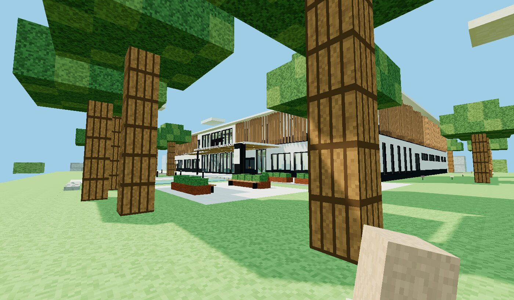
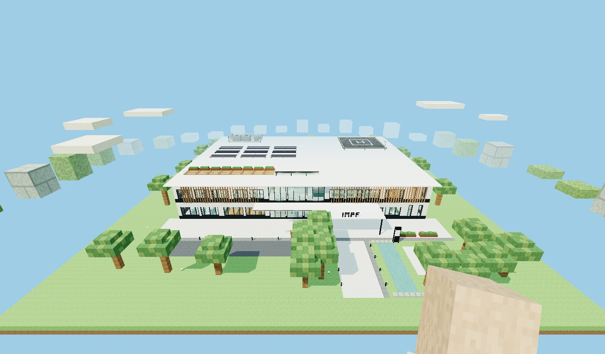
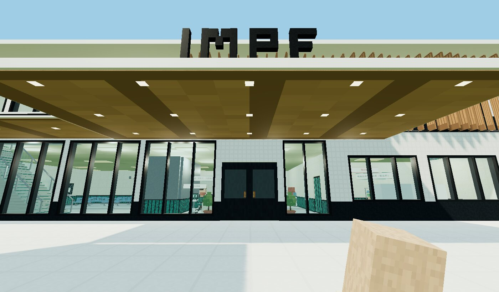
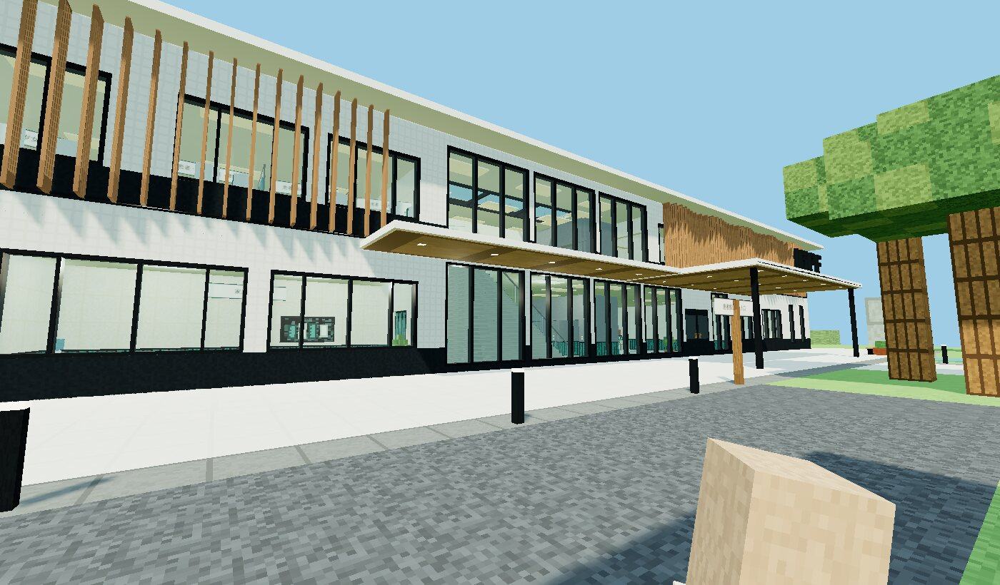
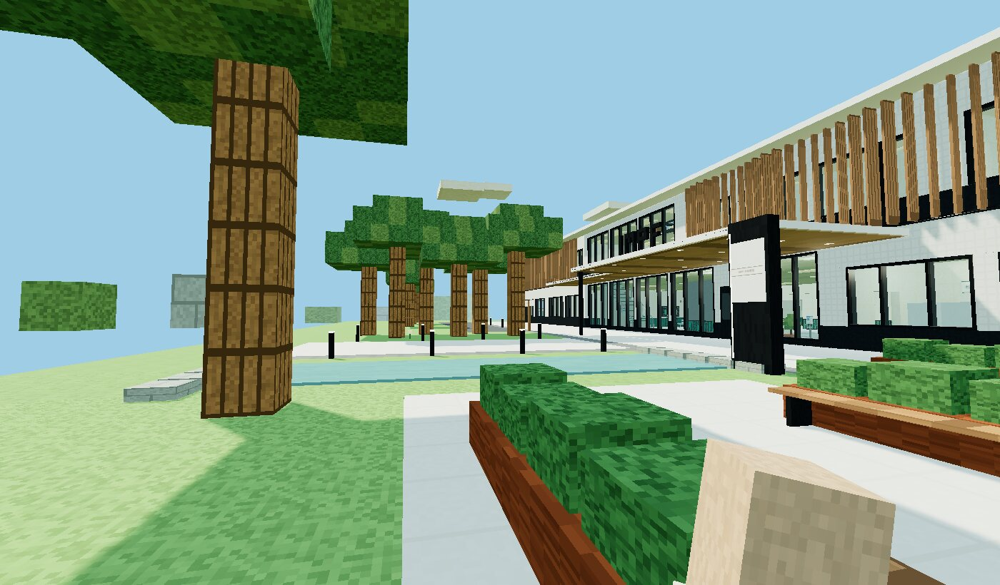
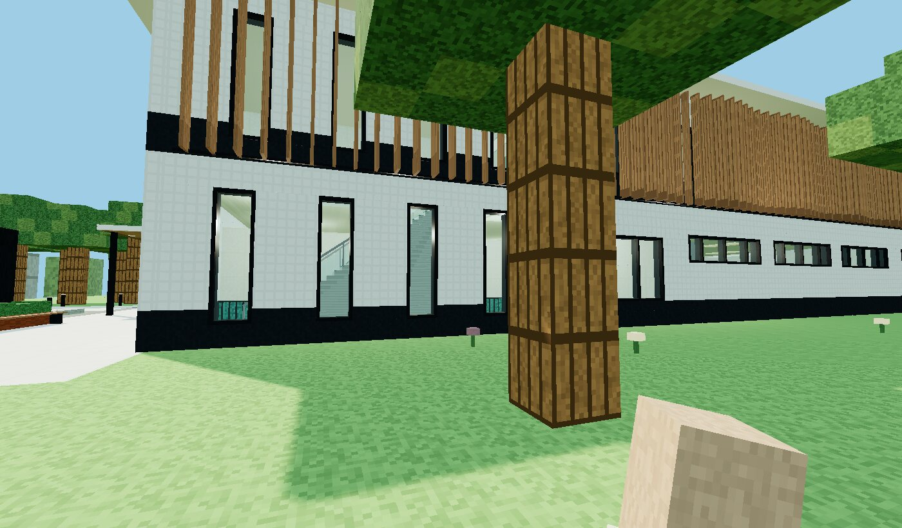
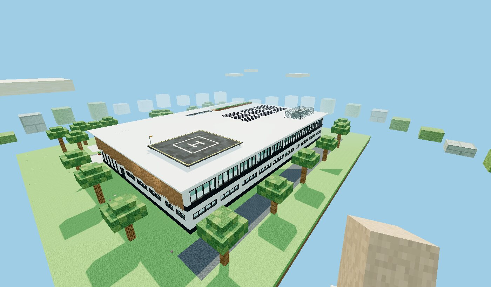

# IMPF Surgery Hospital · exterior · 建筑外观与景观

## Concept · 设计理念

A calm white volume with continuous ribbon glazing, lifted by layers that each do a job:

1. **The envelope.** White rainscreen panels with a dark spandrel band at every floor line. The
   band merges with the ribbon windows into continuous horizontals. Frames and mullions are
   slim graphite aluminium, and a thin white roof plate floats 1.5 m beyond the walls.
2. **The glass lantern.** The entrance hall and the lobby above it are glazed almost floor to
   ceiling over both storeys. The building's public heart is visible from the arrival plaza, and
   daylight reaches the waiting areas.
3. **The fin screen.** Timber-look aluminium fins wrap the operating floor on the south, east and
   west. They sit at 0.6 m centres, and their depth undulates between 0.30 and 0.65 m. They cut
   low-angle sun and overlooking into the PACU, pre-op and corridors, but keep the view out. The
   ground floor stays open; the upper floor is screened.
4. **Arrival.** A floating canopy with a warm timber soffit and recessed downlights carries the
   IMPF letters. A covered walkway runs along the facade from the drop-off lay-by to the door.
   A graphite totem names the hospital beside a reflecting pool.
5. **Landscape.** A light granite forecourt runs along the whole front, with the approach axis
   framed by dark granite bands and light bollards. A tree bosque shelters the west side; on the
   east, the reflecting pool leads to a garden terrace with corten planter-benches for waiting
   families.
6. **The fifth facade.** The roof is designed to be seen from above:
   - a raised helipad with its touchdown marking, safety-area line, perimeter lights and windsock
     (trauma and organ retrieval straight to the hybrid OR);
   - a louvred screen round the rooftop plant;
   - photovoltaic arrays;
   - a skylight over the lobby;
   - two staff gardens with timber decks and planters.

中文：白色雨幕板体量配连续横向带窗，每层楼板线处的深色窗下墙与玻璃连成水平线条；入口大厅与其上的大厅
做成近乎落地的双层通高玻璃“灯笼”；手术部楼层三面以仿木纹铝合金竖向格栅遮阳（翼片间距 0.6 m，进深
0.30–0.65 m 起伏），一层通透、二层遮蔽；入口是带暖色木纹吊顶和 IMPF 立体字的悬挑雨篷，沿立面的有盖连廊
从落客区通到门口；入口广场为浅色花岗岩铺装，深色花岗岩收边、灯柱引导，西侧树阵、东侧镜面水池与花园
平台；屋顶作为“第五立面”设计：抬升的直升机停机坪、设备百叶围护、光伏阵列、大厅天窗和员工屋顶花园。

## Elements

| element | type | where |
|---|---|---|
| Envelope | building `walls`: base `sc-ext-spandrel`, body and top `sc-ext-panel`, `frame` and `mullion` `sc-ext-frame`; roof `sc-ext-roof` with a skylight and graphite beams | the whole building |
| Windows | 87 openings, derived from the rooms behind each facade so none crosses an interior wall: ribbon glazing (sill 1.0 m, 2.6 m high, ≤ 6 m panes on 0.6 m piers), the glass lantern (sill 0.25 m, 4.25 m high, 0.3 m piers), vertical slots in the escape stairs, clerestories in plant and stores | `facility.py` `facade_openings()` |
| Fin screen | `sc-ext-fins`: 4.8 m modules, 8 fins each | operating floor, south (outside the lantern), east and west |
| Entrance canopy | `sc-ext-canopy`, 16 × 7 m, on two `sc-ext-column`s; `sc-ext-letters-impf` on top | the main door |
| Covered walkway | `sc-ext-walkway-canopy`, 15 × 3.5 m, cantilevered | from the drop-off to the canopy |
| Totem | `sc-ext-totem` with the hospital's name | beside the reflecting pool |
| Landscape | terrain: granite forecourt and approach (`sc-ext-paving`, bands `sc-ext-paving-dark`), drop-off lay-by and north service yard (asphalt), reflecting pool, garden terrace, tree bosque; `sc-ext-planter-bench` ×4, `sc-ext-bollard` ×13 | south and east grounds |
| Roof | `sc-ext-helipad` 15 × 15 m, `sc-ext-plant-screen`, `sc-ext-pv-array` ×9, `sc-ext-roof-garden` ×2 | on the roof |

All of it is decor (`interaction: "none"`). Only the canopy columns, the totem and the
planter-benches are solid; everything else stands outside walking routes or above them. The
navigation and zoning checks (`tools/check.sh`) still pass: every room, device and patient bay can
be walked to from the new spawn at the end of the approach. The rooftop gardens and the helipad
are not walkable in the world model; there is no roof access stair.

## Design intent, not engineering

Fin depth and spacing, the canopy and helipad sizes, and the panel and glazing materials follow
common good practice: solar shading on the low-sun facades, a covered drop-off, a helipad sized
for medium helicopters with a safety area. They are illustrations for a teaching world, not
façade, structural or aviation engineering. A real helipad needs an aviation authority's approval
(e.g. ICAO Annex 14 Vol. II, FAA AC 150/5390-2C, CAAS in Singapore).

## Gallery

| | |
|---|---|
|  From the south-east lawn · 东南侧 |  Aerial: plaza, pool, bosque, roof · 鸟瞰 |
|  Under the entrance canopy · 入口雨篷 |  Drop-off and covered walkway · 落客区与连廊 |
|  Reflecting pool and garden terrace · 镜面水池与花园平台 |  East facade: fins over stair slots · 东立面 |
|  The fifth facade: helipad, PV, plant screen, gardens · 屋顶 | |

Rendered in ClinicalCraft's world harness. The envelope's frame and mullion materials need the
ClinicalCraft change ([psknlr/ClinicalCraft#8](https://github.com/psknlr/ClinicalCraft/pull/8)).
