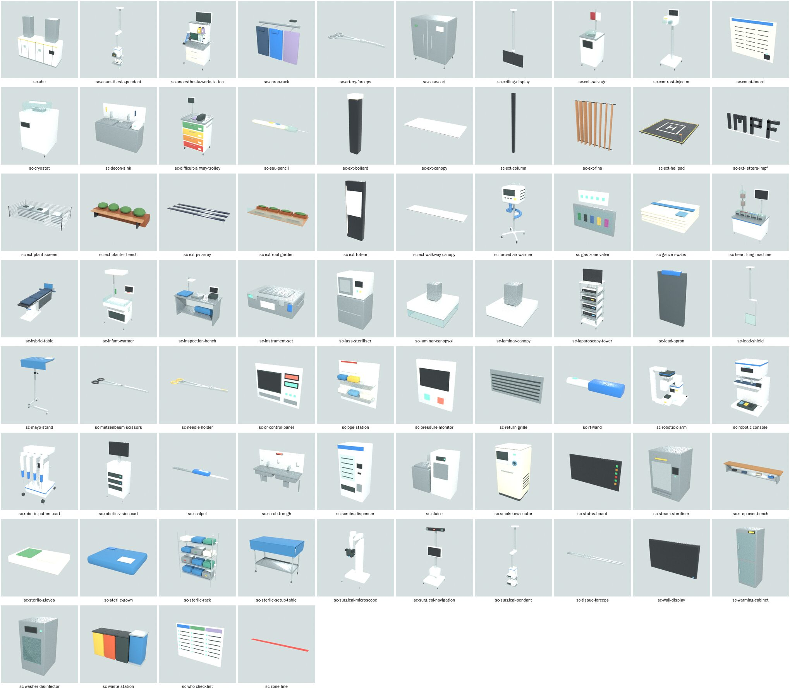
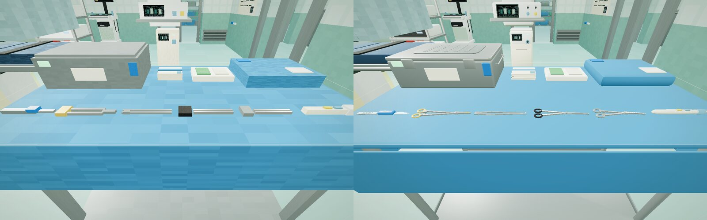
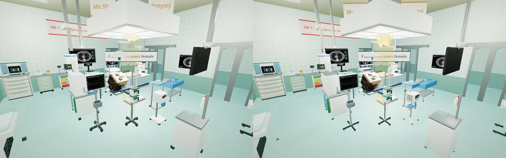
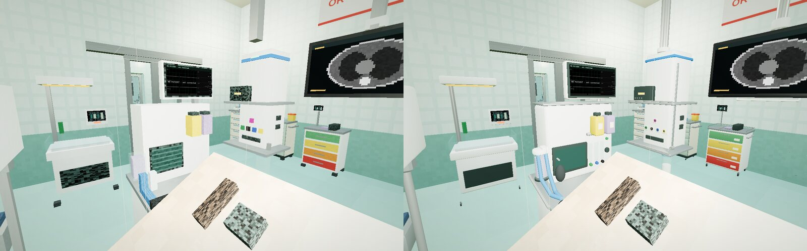
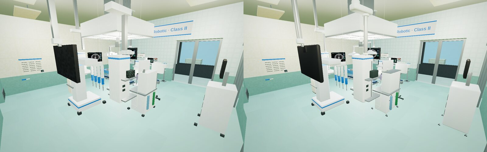
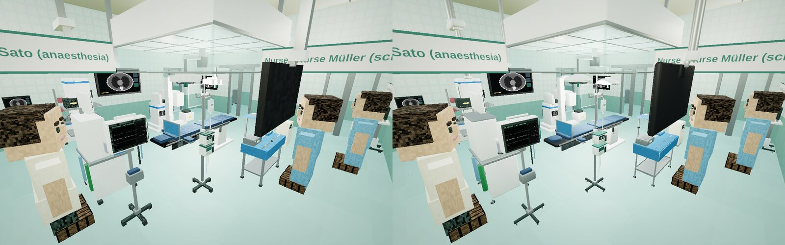
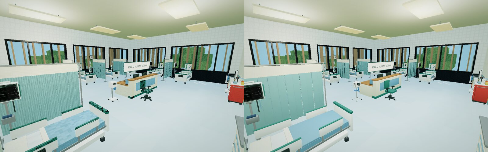

# Equipment models · 设备模型

All equipment in the IMPF Surgery Hospital is drawn as 3D models instead of voxel boxes:
885 placements. That is the pack's 74 types (476 placements) and the 62 ClinicalCraft built-in types
the hospital places (409), whose models ship with ClinicalCraft. Every model was built in
Blender with ClinicalCraft's Blender bridge (ClinicalCraft
[docs/BLENDER.md](https://github.com/psknlr/ClinicalCraft/blob/main/docs/BLENDER.md)), in its
type's own frame, from the type's voxel parts. Working heights, screens and the surfaces
things are put on stay where the world expects them, so every interaction works as before.
The voxel parts remain the fallback, and the collider and aim box are still the footprint.

> IMPF 外科医院中的全部设备（885 处摆放）都改用三维模型绘制：本内容包的 74 种设备（476 处）
> 和医院用到的 62 种 ClinicalCraft 内置设备（409 处，模型随 ClinicalCraft 提供）。每个模型都用
> ClinicalCraft 的 Blender 桥接，在该设备类型自身的坐标系中、依据其体素部件在 Blender 中制作，
> 工作高度、屏幕位置和放置物品的台面都与原来一致，所有交互不变；体素部件仍是后备，碰撞体与
> 瞄准框仍是占地范围。



In the hospital, before (voxel parts) → after (models), in `clinicalcraft serve`:


*OR 7 back table: safety scalpel, Mayo-Hegar needle holder (gold rings), DeBakey forceps,
Metzenbaum scissors (black rings), Kelly forceps, ESU pencil; the rigid container with its
filter lid; the swabs; the drape over the table.*


*OR 7: the surgical light, laminar-flow canopy, anaesthesia workstation, monitors and pumps on
their stands, the warmer, Mayo stand, trolleys and displays.*


*The anaesthesia workstation: vaporisers on their rail, flowmeters, ventilator display, CO2
absorber, breathing circuit, bag and mask. The patient monitor on top still shows the world's
live vitals.*


*OR 2 (robotic): the patient cart with its four arms, the vision cart, the surgical pendant.*


*OR 1 (hybrid): the hybrid table, the surgical light's two domed heads, the robotic C-arm, the
anaesthesia workstation and pendants, the back table.*


*The PACU: beds, monitors, curtains, the nurses' station.*

## How they are made

19 types have their own builder in `tools/blender/models.py`: the instruments, back table, Mayo
stand, anaesthesia workstation, both pendants, laparoscopy tower, smoke evacuator, warmer,
airway trolley, ceiling displays and the hybrid table. The other 55 are refined from their
voxel parts by ClinicalCraft's `clinicalcraft_refine`:
- boxes get rounded edges, and thin bars and poles become cylinders;
- small floor cubes become casters or glides;
- circles drawn in voxels (lamp heads, clock faces) become discs;
- each screen gets a dark housing for the live display;
- foliage becomes rounded blobs.

The pack's models total 130,624 triangles in 6.9 MB.

Each model is one mesh with one material, plus one for glass where there is any. Colours are
vertex colours; roughness, metalness and glow come from a small palette texture. Static
placements of one model are drawn as instances per floor and 16 m square, and items under
0.3 m cast no shadow. Measured in OR 7's wide view against the all-voxel world (headless
Chromium, 2026-10-31):
- steady draw calls: 382 → 637;
- shadow pass: 602 → 1,118 (it runs only when the shadow map is refreshed);
- triangles: 0.12 M → 0.75 M.

## Licence and provenance

The models are this repository's own work and are licensed **MIT**, the same as ClinicalCraft.
Each catalog reference records `license`, `attribution`, a `source` (this repository, the
Blender version that built it, what was done) and the use status `cleared` (ClinicalCraft
ASSETS.md). To license them differently, change `LICENSE` in `tools/blender/build.py` and
rebuild. A model taken from elsewhere (Poly Haven, Sketchfab, a dataset) goes in only as
`cleared`, with its own source and licence. Research-only or unchecked models stay in
ClinicalCraft's `assets/local/`, never here.

## Build, check, change

```
tools/blender/
  build.py      builds a model for every type of the catalog (or the ones named) and writes models.json
  models.py     the bespoke builders, in each type's frame (ClinicalCraft's shape kit); other types are refined
  models.json   the catalog references (sha256, offset, licence, source, use), read by content-gen
  preview.py    Cycles previews of the built models (the sheet above)
content/assets/models/<type>.glb   the models, served by `clinicalcraft serve` at /local-assets/models/
```

The builds need ClinicalCraft next to this repository (or `$CLINICALCRAFT_DIR`) and Blender 4.1+
headless, or a Python 3.11 with the `bpy` module (`pip install bpy`):

```bash
blender -b -P tools/blender/build.py
```

```bash
python3 tools/content-gen/build.py
```

```bash
tools/check.sh ../ClinicalCraft
```

`build.py` takes type ids to rebuild only those (`-- sc-mayo-stand` after `-P …` with
`blender`). The content generator puts each reference into the catalog and refuses one whose
file is missing. `check.sh` inspects every model against its reference: licence, use status,
pinned hash, and size against the footprint. Warnings are expected for wall panels and the
hanging display, whose footprints are deeper than the panel itself (as their voxel parts
already are). Builds are reproducible: the same code and Blender version give the same bytes,
so the pinned hashes change only when a model does. A new type in the catalog gets a refined
model on the next build; give it a builder in `models.py` when refining is not enough.

### With Claude Code and blender-mcp

`.mcp.json` registers blender-mcp 1.8.7 (telemetry off) for Claude Code; set-up and privacy
notes are in ClinicalCraft's docs/BLENDER.md (untick the add-on's "Allow Telemetry"). With
Blender open and its server started, ask for example:

> Load `sc-robotic-console` from content/ with the ClinicalCraft Blender bridge, show me its
> blockout and its refined model, then model it better with the shape kit, like the builders
> in tools/blender/models.py.

When it looks right, turn it into a builder in `models.py`, so that the model is rebuilt from
code like the others, then build, regenerate and check as above.
