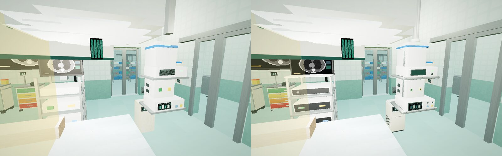
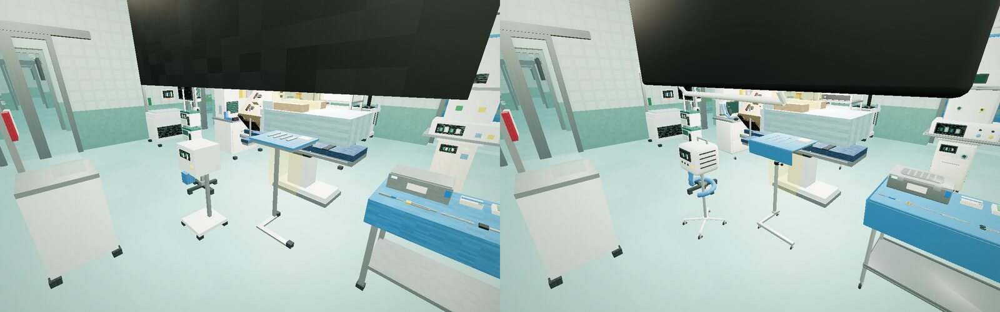

# Equipment models · 设备模型

The operating department's most-seen equipment is drawn as real 3D models instead of
voxel boxes: 19 types, 173 placements in the IMPF Surgery Hospital. Each model was built in
Blender with ClinicalCraft's Blender bridge (ClinicalCraft
[docs/BLENDER.md](https://github.com/psknlr/ClinicalCraft/blob/main/docs/BLENDER.md)), in its
type's own frame, from the type's voxel parts. Working heights, screens and the surfaces
things are put on stay where the world expects them, so every interaction works as before.
The voxel parts remain the fallback, and the collider and aim box are still the footprint.

> 手术部最常见的 19 种设备（IMPF 外科医院中 173 处摆放）改用真实三维模型绘制：每个模型都用
> ClinicalCraft 的 Blender 桥接，在该设备类型自身的坐标系中、依据其体素部件在 Blender 中制作，
> 工作高度、屏幕位置和放置物品的台面都与原来一致，所有交互不变；体素部件仍是后备，碰撞体与
> 瞄准框仍是占地范围。


In the hospital, before (voxel parts) → after (models), in `clinicalcraft serve`:


*OR 7 back table: safety scalpel, Mayo-Hegar needle holder (gold rings), DeBakey forceps,
Metzenbaum scissors (black rings), Kelly forceps, ESU pencil; the rigid container with its
filter lid; the swabs; the drape over the table.*


*The anaesthesia workstation: vaporisers on their rail, flowmeters, ventilator display, CO2
absorber, breathing circuit, bag and mask. The patient monitor on top still shows the world's
live vitals.*


*The surgical pendant (electrosurgical generator with its live screen, gas outlets), the
laparoscopy tower and the smoke evacuator.*


*The Mayo stand and the forced-air warmer, under a ceiling-boom display.*


*OR 1 (hybrid): the hybrid table, the anaesthesia workstation and pendants, the back table.*

## The models

| type | | triangles | primitives | placements | portable | screen |
|---|---|---:|---:|---:|---|---|
| `sc-anaesthesia-pendant` | Anaesthesia pendant | 6,960 | 7 | 9 |  |  |
| `sc-anaesthesia-workstation` | Advanced anaesthesia workstation | 9,612 | 5 | 10 |  | vitals |
| `sc-artery-forceps` | Curved artery forceps (Kelly) | 1,976 | 1 | 9 | yes |  |
| `sc-ceiling-display` | Ceiling-boom 4K surgical display | 1,884 | 3 | 18 |  | pacs |
| `sc-difficult-airway-trolley` | Difficult airway trolley | 5,576 | 3 | 9 | yes | text |
| `sc-esu-pencil` | Electrosurgical pencil | 692 | 3 | 9 | yes |  |
| `sc-forced-air-warmer` | Forced-air warming unit | 7,488 | 4 | 12 | yes | text |
| `sc-gauze-swabs` | X-ray-detectable RFID swabs | 848 | 1 | 9 | yes |  |
| `sc-hybrid-table` | Hybrid OR table | 4,824 | 5 | 1 |  |  |
| `sc-instrument-set` | Rigid sterile container | 1,932 | 4 | 9 | yes |  |
| `sc-laparoscopy-tower` | 4K/3D laparoscopy tower | 5,592 | 5 | 6 | yes | pacs |
| `sc-mayo-stand` | Mayo instrument stand | 4,740 | 3 | 9 |  |  |
| `sc-metzenbaum-scissors` | Metzenbaum scissors | 1,608 | 2 | 9 | yes |  |
| `sc-needle-holder` | Mayo-Hegar needle holder | 1,536 | 2 | 9 | yes |  |
| `sc-scalpel` | Safety scalpel | 784 | 3 | 9 | yes |  |
| `sc-smoke-evacuator` | Surgical smoke evacuator | 1,940 | 4 | 9 |  | text |
| `sc-sterile-setup-table` | Sterile set-up table | 3,668 | 2 | 9 |  |  |
| `sc-surgical-pendant` | Surgical equipment pendant | 5,660 | 6 | 9 |  | text |
| `sc-tissue-forceps` | DeBakey tissue forceps | 1,044 | 1 | 9 | yes |  |

*Primitives* are draw calls per drawn copy. Static placements of one model are instanced (one
draw call per primitive for all of them); portable ones are drawn one by one. In OR 7's wide
view the models take the frame from 382 to 554 steady draw calls, and the shadow pass from 602
to 789 (headless Chromium, 2026-10-31). The shadow pass runs only when the shadow map is
refreshed. Instruments, swabs and the container cast no shadow.

Not modelled yet: the wall panels with behaviours (control panel, WHO checklist, count board),
the robotic system, the C-arm and lead shield, CSSD machines, the exterior, and the core types
the ORs also use (`operating-table`, `surgical-light`, `patient-monitor`; ClinicalCraft's own
catalog).

## Licence and provenance

The models are this repository's own work and are licensed **MIT**, the same as ClinicalCraft.
Each catalog reference records `license`, `attribution`, a `source` (this repository, the
Blender version that built it, what was done) and the use status `cleared` (ClinicalCraft
ASSETS.md). To license them differently, change `LICENSE` in `tools/blender/build.py` and
rebuild. A model taken from elsewhere (Poly Haven, Sketchfab, a dataset) goes in only as
`cleared`, with its own source and licence. Research-only or unchecked models stay in
ClinicalCraft's `assets/local/`, never here.

## Build, check, change

```
tools/blender/
  build.py      builds every model (or the ones named) and writes models.json
  models.py     one builder per type, in the type's frame (ClinicalCraft's shape kit)
  models.json   the catalog references (sha256, offset, licence, source, use), read by content-gen
  preview.py    Cycles previews of the built models (the sheet above)
content/assets/models/<type>.glb   the models, served by `clinicalcraft serve` at /local-assets/models/
```

The builds need ClinicalCraft next to this repository (or `$CLINICALCRAFT_DIR`) and Blender 4.1+
headless, or a Python 3.11 with the `bpy` module (`pip install bpy`):

```bash
blender -b -P tools/blender/build.py
```

```bash
python3 tools/content-gen/build.py
```

```bash
tools/check.sh ../ClinicalCraft
```

`build.py` takes type ids to rebuild only those (`-- sc-mayo-stand` after `-P …` with
`blender`). The content generator puts each reference into the catalog and refuses one whose
file is missing. `check.sh` inspects every model against its reference: licence, use status,
pinned hash, and size against the footprint. One warning is expected: `sc-ceiling-display`'s
footprint (floor to ceiling, 0.6 m deep) is larger than the hanging display, as its voxel parts
already are. Builds are reproducible: the same `models.py` and Blender version give the same
bytes, so the pinned hashes change only when a model does.

### With Claude Code and blender-mcp

`.mcp.json` registers blender-mcp 1.8.7 (telemetry off) for Claude Code; set-up and privacy
notes are in ClinicalCraft's docs/BLENDER.md (untick the add-on's "Allow Telemetry"). With
Blender open and its server started, ask for example:

> Load `sc-robotic-console` from content/ with the ClinicalCraft Blender bridge, show me its
> blockout, and model it with the shape kit like the builders in tools/blender/models.py.

When it looks right, turn it into a builder in `models.py`, so that the model is rebuilt from
code like the others, then build, regenerate and check as above.
