# IMPF Surgery Hospital · surgical floor · 二层 · 手术部

The operating department of **IMPF Surgery Hospital** (`impf-surgery-hospital`, IMPF 外科医院), a
two-storey hospital for the ClinicalCraft engine. The first floor (L1) is the surgical floor:
eight operating rooms designed to **the strictest of the Singaporean, European, US and Japanese
requirements** for each topic ([STANDARDS.md](STANDARDS.md)), plus everything an operating
department needs around them. The ground floor (L0) holds the services the floor depends on:
admissions, the central sterile services department (CSSD), the perioperative lab and blood
bank, a surgical skills and simulation centre and the OR plant.

People, instruments and devices **interact**: each OR has its team, every instrument has a
lifecycle and the safety-critical devices are state machines whose rules depend on each other —
no incision before the time-out, no energy without smoke evacuation, no sign-out before the
counts reconcile with an RF scan, no reuse before the CSSD ([INTERACTIONS.md](INTERACTIONS.md)).

Everything is data for ClinicalCraft; the interactions use the general mechanics of its hands
round ([psknlr/ClinicalCraft#7](https://github.com/psknlr/ClinicalCraft/pull/7)). The content passes `clinicalcraft facilities validate --all` with
**0 errors and 0 warnings**, and ClinicalCraft's own world model confirms that every room, device
and patient bay can be walked to and that every workflow runs (see [§8](#8-validation)).


## At a glance

| | |
|---|---|
| Operating rooms | 8: hybrid (robotic angiography), robotic, 2 × Class I ultra-clean, 3 × integrated digital (one held 24/7 for emergency & obstetric surgery), 1 × negative-pressure isolation |
| Perioperative | 8-bay PACU, 5-bay pre-op holding, patient transfer zone (换床间), theatre control desk |
| OR support | 6 scrub bays, 6 sterile set-up (lay-up) rooms, 58 × 8 m sterile core with clean lift, hybrid control room, anaesthesia workroom (satellite blood fridge, blood gas), frozen-section lab, theatre pharmacy, equipment store, soiled utility with dirty lift |
| Staff areas | one-way changing rooms (women / men) with step-over benches and scrub dispensers, staff lounge, staff corridor |
| OR teams | a scrub nurse, a circulating nurse and an anaesthetist in each OR and the simulation OR, by name |
| Interactions | 12 handheld instruments and wearables with lifecycles; 19 operable state machines (64 operations) gated by hand hygiene, worn apparel, roles and the state of nearby devices; "pass me …" to any colleague; 3 workflow skills |
| Ground floor | main hall & admissions, family lounge, day surgery, 2 pre-anaesthesia clinics, perioperative lab, blood bank, CSSD (decontamination → packing & sterilising → sterile store), skills lab, OR live-video room, simulation OR + debrief, AHU plant room, stores |
| Vertical links | 2 bed lifts, clean lift (CSSD → sterile core), dirty lift (soiled utility → decontamination), main stairs, escape stairs |
| Size | building 64 × 44 m, two 5 m storeys; 69 rooms (46 on L1), 822 placements (577 on L1, 101 of them handheld), 21 patient slots, 40 staff, 22 access zones |
| Content | 1 facility, 15 room templates, 1 catalog with 62 equipment types and 21 materials, 3 skills (all bilingual zh-CN / en) |

## 中文概要

IMPF 外科医院按新加坡、欧洲、美国和日本规范中每一项最严格的要求设计（见 [STANDARDS.md](STANDARDS.md)）：
每间手术室 ≥ 25 次/h 换气，超净手术室手术区 ISO 5、浮游菌设计均值 ≤ 5 CFU/m³，相邻区域压差 15 ± 5 Pa，
净面积 ≥ 55.74 m²，≥ 36 个插座与 IT 隔离电源，无影灯不间断电源，医用气体 400 ± 40 kPa。

人、器械和设备可以交互（见 [INTERACTIONS.md](INTERACTIONS.md)）：每间手术室有洗手护士、巡回护士和麻醉医生；
说“把手术刀递给我”或“纱布”，洗手护士就会拿起器械走过来递给你；器械有“无菌 → 使用中 → 待再处理”的
生命周期，用过的器械必须送到一层消毒供应中心清洗消毒、灭菌放行后才能再次使用；切皮前必须完成手卫生、
穿无菌手术衣戴手套、WHO 暂停核查（需先完成切皮前清点）；电刀需要烟雾排除器运行；离室前核查需要最终
清点相符，而最终清点需要 RF 检测棒扫描阴性；复合手术室透视下注射需要穿铅衣、铅屏风就位。

二层手术部采用“中央无菌核心区 + 环形洁净走廊”的布局：8 间手术室围绕无菌核心区排成南北两排，
手术室一侧开向无菌核心区（无菌物品），另一侧开向半限制区洁净走廊（患者与医护）。按 AORN/FGI 的
限制区 / 半限制区 / 非限制区三级流线组织：医护从非限制区的员工通道进入男女更衣室，跨过换鞋凳、
领取洗手衣后从内区门进入洁净走廊；病房患者乘病床电梯到达手术部入口厅，在换床间换乘手术平车。
术毕经南侧走廊进入麻醉后恢复室（8 床）。洁净电梯直达一层消毒供应中心的无菌物品存放区，污梯从
污物间直达去污区，器械在一层按“去污 → 检查包装灭菌 → 无菌存放”单向流转。

手术室类型：1 号复合手术室（机器人落地式血管造影、碳纤维浮动手术床、Ⅰ级层流、铅防护、控制室）、
2 号机器人手术室、3 号心脏/移植与 4 号骨科关节/神经外科超净层流手术室（3.2 × 3.2 m 送风天花）、
5、6、7 号一体化数字手术室（7 号为 24 小时急诊与产科手术间，配新生儿复苏台与自体血回收）、
8 号负压隔离手术室（经互锁门缓冲间进出）。每间手术室配麻醉吊塔、外科吊塔、高级麻醉工作站、
监护仪、4K 吊臂显示器、环境控制面板（温湿度、压差、层流状态、气体报警）、WHO 手术安全核查板和
对角下回风口。房间、设备和标识全部中英双语。

## 1. Planning concept

**Clean core with a racetrack of clean corridors.** The ORs sit in two rows of four around a
58 × 8 m sterile core. Each OR has two lives: its *corridor door* (2.4 m sliding, local
south) for the patient and the team, and its *core door* (1.6 m sliding) for sterile supplies.
Between neighbouring ORs a **scrub bay** opens onto the corridor and a **sterile set-up room**
(HBN 26's "preparation room") opens onto the core, both with sliding doors into the two ORs.
Clean corridors (3 m, ≈ 2.65 m clear) ring the block, so a trolley never has to pass through
a theatre to reach another one. This is the classic US "clean core" plan and the central
sterile-corridor layout familiar from Chinese clean operating departments (洁净手术部).

**Three-zone traffic model** (AORN / FGI), expressed as ClinicalCraft access zones — the
world model refuses to plan a route through a zone for a role that is not listed, and zones
that overlap intersect their roles:

| zone | rooms | roles allowed |
|---|---|---|
| Unrestricted · 非限制区 | L1 lobby, staff corridor, changing rooms' outer side; the whole ground floor except below | everyone |
| Semi-restricted · 半限制区 | clean corridors, scrub bays, PACU, pre-op, transfer zone, control desk, support rooms, lounge | clinician, attending, nurse, porter, radiologist, pathologist, lab-tech, pharmacist (not receptionist or paramedic) |
| Restricted · 限制区 | each OR (template zone `sterile`) | clinician, attending, nurse, porter (+ radiologist in the hybrid OR) |
| Restricted · 限制区 | sterile core, set-up rooms | clinician, attending, nurse (porters stay out) |
| Restricted | isolation anteroom (`buffer`) | clinician, attending, nurse, porter |
| Staff only (L0) | CSSD; plant room | nurse, porter, clinician, attending; porter, clinician, attending |

A red floor line (`sc-zone-line`) marks the semi-restricted boundary at the transfer zone and
at both changing-room exits; room signs carry the zone rules ("Semi-restricted · scrubs, cap
& mask").

**Flows.**

* *Patients* — bed lift → L1 lobby → transfer zone (ward bed to theatre trolley at the red
  line) → pre-op holding or straight along the south corridor → OR → PACU → bed lift.
  Ward beds never enter the semi-restricted zone.
* *Staff* — stairs or lift → staff corridor → changing room (outer lockers, step-over bench,
  scrub dispenser, caps & masks) → south clean corridor. One-way: the entry door is on the
  unrestricted side (south-west), the exit on the corridor side (north-east).
* *Sterile supplies* — CSSD sterile store → clean lift → sterile core → set-up room / core
  door → OR. The clean lift is restricted to nurses.
* *Soiled return* — OR → corridor in a closed cart → soiled utility → dirty lift → CSSD
  decontamination. The dirty lift is restricted to nurses and porters.

## 2. Room schedule — first floor

Sizes are room rectangles (walls are 0.35 m, so clear dimensions are ≈ 0.35 m smaller).

| room | 名称 | size (m) | template | notes |
|---|---|---|---|---|
| OR 1 · Hybrid | 1 号复合手术室 | 11 × 9 (≈ 92 m² clear) | `sc-or-hybrid` | robotic angiography C-arm, carbon-fibre floating table, Class I canopy, lead shield & curtain, injector, heart-lung machine on standby, TOE; lead-glass window to its control room |
| Hybrid control room | 复合手术室控制室 | 4 × 9 | `sc-or-hybrid-control` | angiography console facing the window, generator / UPS / image-processing cabinets, interventional radiologist |
| OR 2 · Robotic surgery | 2 号机器人手术室 | 9 × 9 (≈ 75 m² clear) | `sc-or-robotic` | patient-side cart docked at the table, surgeon console with sight of the field, vision cart |
| OR 3 · Cardiac & transplant | 3 号心脏/移植 | 9 × 9 | `sc-or-ultraclean` | Class I 3.2 × 3.2 m canopy; + heart-lung machine, cell salvage |
| OR 4 · Arthroplasty & neuro | 4 号骨科关节/神经 | 9 × 9 | `sc-or-ultraclean` | Class I canopy, mobile C-arm; + optical navigation, operating microscope |
| OR 5 · General & colorectal MIS | 5 号普外腔镜 | 9 × 9 | `sc-or-integrated` | 4K/3D laparoscopy tower, Class II canopy |
| OR 6 · Urology, gynaecology & ENT MIS | 6 号腔镜 | 9 × 9 | `sc-or-integrated` | as OR 5 |
| OR 7 · Emergency & obstetric (24/7) | 7 号急诊/产科 | 9 × 9 | `sc-or-integrated` | + neonatal resuscitation warmer, cell salvage; first slot for operating-room cases |
| OR 8 · Negative-pressure isolation | 8 号负压隔离 | 9 × 9 | `sc-or-isolation` | entered only through its anteroom; pressure monitor; no core or corridor door |
| OR 8 anteroom | 缓冲间 | 3 × 9 | `sc-or-anteroom` | interlocked doors, scrub trough, PPE donning station, pressure monitor |
| Scrub bays ×6 | 刷手间 | 3 × 4 | `sc-scrub-bay` | twin sensor scrub trough, scrub clock, caps & masks; open to the corridor |
| Set-up rooms ×6 | 无菌准备间 | 3 × 5 | `sc-prep-room` | sterile rack, lay-up table, case cart; doors to the core and both ORs |
| Sterile core | 无菌核心区 | 58 × 8 | authored | 30 sterile racks in 5 islands, case carts, immediate-use steriliser, warming cabinets, implant store, clean lift |
| Anaesthesia workroom | 麻醉准备间 | 7 × 4.5 | `sc-anaesthesia-workroom` | spare workstation, difficult-airway trolley, satellite blood fridge, blood gas analyser, drug cabinet & fridge, defibrillator, block ultrasound |
| Frozen-section lab | 术中冰冻病理室 | 4.5 × 7 | `sc-frozen-section-lab` | cryostat, rapid staining, microscope, slide scanner; pathologist |
| Theatre pharmacy | 卫星药房 | 7 × 4.5 | authored | automated dispensing & double-locked controlled-drugs cabinets; pharmacist |
| Equipment store | 设备存放间 | 7 × 4.5 | authored | spare C-arm, laparoscopy tower, pumps, warmers |
| Soiled utility & dirty lift | 污物间 | 3 × 9 | authored | sluice, segregated waste, closed return cart, dirty lift |
| PACU | 麻醉后恢复室 | 14 × 12 | `sc-pacu-8` | 8 bays round a central station in direct view; monitors with capnography, piped O₂/suction, crash cart, defibrillator, ventilator, difficult-airway trolley, POC blood gas, warmers |
| Pre-op holding | 术前准备区 | 9 × 12 | `sc-preop-holding` | 5 monitored bays, check-in desk, block ultrasound; door to the transfer zone |
| Transfer zone | 换床间 | 5 × 4 | authored | theatre trolley, red line; doors to lobby, pre-op and corridor |
| Theatre control desk | 手术部控制台 | 10 × 4 | authored | coordination desk open to the corridor, schedule & status board, reception hatch to the lobby; charge nurse and duty anaesthetist |
| Changing rooms ×2 | 男/女更衣室 | 7 × 9 | `sc-staff-changing` | outer lockers → step-over bench → scrub dispenser, sink, caps & masks → inner lockers |
| Lobby, staff corridor, lounge, escape stair | 入口厅、员工通道、休息室、疏散楼梯 | — | authored | 2 bed lifts and the main stairs land in the lobby |

## 3. The operating rooms

All ORs share one equipment skeleton, arranged as a compact **clinical island** — table,
anaesthesia workstation and monitor at the head, anaesthesia and surgical pendants, the sterile
set-up table, Mayo stand, infusion pump and warmer — with at least 1.3 m clear all round it (see
[§7](#7-authoring-rules-learned-from-the-engine)):

* ceiling unidirectional-flow supply canopy with terminal HEPA filters over the table
  (`sc-laminar-canopy` 2.6 × 2.6 m, or `sc-laminar-canopy-xl` 3.2 × 3.2 m with glass skirts
  for Class I rooms); LED surgical light;
* **anaesthesia pendant** with O₂, medical air, N₂O, vacuum and AGSS outlets and
  isolated-power sockets; **surgical pendant** with electrosurgical unit and insufflator;
* **advanced anaesthesia workstation** (ISO 80601-2-13: ventilator modes, agent and
  end-tidal monitoring); bedside monitor linked to the patient slot;
* ceiling-boom 4K displays and a wall PACS / integration display;
* the **OR environment & control panel** (temperature, humidity, pressure to the corridor,
  laminar-flow status, medical-gas alarms, surgical and anaesthesia timers) and the
  **WHO Surgical Safety Checklist** board (Sign in · Time out · Sign out);
* low-level return grilles at opposite corners; drug cabinet, IV cannulation cart, EHR
  terminal, hand rub;
* the **sterile set-up table** laid out to the tray list — rigid instrument container, counted
  RFID swabs, sterile gown and gloves, safety scalpel, needle holder, tissue forceps, dissecting
  scissors, artery forceps, ESU pencil with smoke shroud — all handheld, with lifecycles and UDI;
* a **ULPA smoke evacuator** beside the surgical pendant, the **surgical count board** with the
  **RF sponge-detection wand** in its cradle, and the OR team at their posts.

| type | used for | what sets it apart |
|---|---|---|
| **Hybrid** (`sc-or-hybrid`) | TAVI, EVAR/TEVAR, hybrid neurovascular and trauma | floor-mounted robotic angiography C-arm parked clear of the field, radiolucent carbon-fibre floating table, ceiling lead shield and table-side lead curtain, contrast injector, lead-apron rack, heart-lung machine on standby; control room behind lead glass. Planning references give ≈ 70 m² (floor-mounted) to ≈ 85 m² (ceiling-mounted) plus ≥ 10 m² control/technical room; this room has ≈ 92 m² clear. Shielding is set by a medical physicist (commonly 1.5–3 mm lead equivalent). |
| **Robotic** (`sc-or-robotic`) | robotic-assisted urology, gynaecology, colorectal, thoracic | patient-side cart with four arms, surgeon console, vision cart |
| **Ultra-clean** (`sc-or-ultraclean`) | arthroplasty, spine, cardiac, transplant | 3.2 × 3.2 m TAV / UCV canopy with skirts (GB 50333 Class I · DIN 1946-4 class Ia · HTM 03-01 UCV); the second back table sits inside the protected zone; mobile C-arm |
| **Integrated digital** (`sc-or-integrated`) | general, MIS, emergency | 4K/3D laparoscopy tower, ultrasound/TOE, difficult-airway trolley (GB 50333 Class II) |
| **Isolation** (`sc-or-isolation`) | airborne/droplet-transmitted infection | switchable pressure, entered only through an interlocked anteroom that holds the corridor → anteroom → OR cascade; HEPA-filtered exhaust; pressure monitors at both doors |

OR 7 adds a neonatal resuscitation warmer (O₂, suction, T-piece, Apgar timer) and cell
salvage for obstetric haemorrhage; OR 3 adds a heart-lung machine and cell salvage; OR 4 adds
optical navigation and an operating microscope.

## 4. Standards basis

The full matrix — Singapore, Europe, USA and Japan side by side, with sources — is
[STANDARDS.md](STANDARDS.md). For each topic IMPF takes the strictest requirement:

| topic | IMPF target | strictest source |
|---|---|---|
| Air changes | ≥ 25 total, ≥ 4 outdoor ACH in every OR | HTM 03-01 (> ASHRAE 170's 20, > Japan's 15) |
| Ultra-clean ORs (1, 3, 4) | ISO 5 operating zone; ≤ 10 CFU/m³ in use, design mean ≤ 5; 3.2 × 3.2 m unidirectional zone over the table **and** the opened instrument tables; non-aspirating array | NF S 90-351, SIS/TS 39:2025, DIN 1946-4 Ia, SWKI 1a, ASHRAE 170 |
| Pressure | positive OR; 15 ± 5 Pa between zones; isolation OR negative behind an interlocked anteroom | NF S 90-351 |
| Climate · filters | 20–24 °C, 35–60 % RH; MERV-16 then terminal HEPA ≥ 99.97 % | ASHRAE 170, AfPP, HEAS-02 |
| OR size | ≥ 55.74 m² clear, ≥ 6.1 m minimum dimension (built: ≈ 75 m², hybrid ≈ 92 m²) | FGI |
| Electrical | ≥ 36 receptacles; medical IT systems with insulation monitoring; uninterruptible supply for the surgical lights | NFPA 99 / NEC 517.19, IEC 60364-7-710, JIS T 1022:2023 |
| Medical gases | O₂, air, N₂O, vacuum, AGSS/WAGD, instrument air; 400 ± 40 kPa; O₂ ≥ 60 NL/min | JIS T 7101:2020, FGI / NFPA 99 |
| Monitoring | SpO₂, capnography, ECG, NIBP ≤ 5 min, temperature, neuromuscular | JSA 2019 |
| Practice (gated in game) | WHO Sign in · Time out · Sign out; counts at the four JAOM points with the RF adjunct; smoke evacuation for all energy; hand hygiene, gown and gloves; lead apron and shield for injections under fluoroscopy; CSSD reprocessing before reuse | WHO, JAOM 2019, AORN, MOH Singapore IPC, IEC 61331-3, ISO 15883 / ISO 17665 |
| Instruments · apparel | stainless to ISO 7153-1 / ASTM F899-23, autoclave-tested to ISO 13402:2025, UDI direct-marked (EU MDR, 21 CFR 801.45); gowns AAMI PB70 Level 4 / EN 13795-1 | see [STANDARDS.md §3](STANDARDS.md#3-instruments-apparel-and-devices) |

Choices made deliberately: no separate anaesthetic induction rooms (induction in the OR, as
in US and Chinese practice; HBN 26 plans one per theatre), and the PACU kept on the floor
inside the semi-restricted zone.

## 5. Ground floor

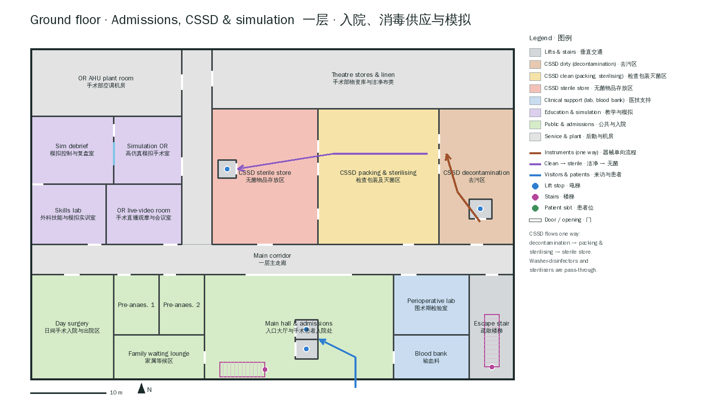

The entrance (south, x = 11) opens into a 25 × 14 m hall with surgical admissions, the
family progress board and the lifts. West: day surgery, family lounge and two pre-anaesthesia
clinics. East: the perioperative stat lab (`clinical-lab`) and the blood bank (three blood
refrigerators, plasma freezer, cross-match bench). North of the main corridor the CSSD runs
east to west in one direction: decontamination (dirty lift, washer-disinfectors in the wall)
→ inspection, packing & sterilisation (6 benches, low-temperature steriliser, pass-through
steam sterilisers in the wall) → sterile store (24 racks, dispatch, clean lift). The west wing
is the surgical skills & simulation centre — skills lab with the anatomy atlas and case board,
an OR live-video room, a high-fidelity simulation OR (an integrated OR without a patient slot)
and its debrief room behind an observation window — and the OR air-handling plant room with
three dedicated AHUs.

## 6. Gameplay

* **Hosting cases.** All 21 patient slots accept the `operating-room` setting and OR 7's slot
  comes first, so an operating-room case starts in the emergency & obstetric theatre. The
  built-in operating-room case (`cmcr-1653406`, term pregnancy awaiting caesarean section) can
  be completed here: every capability it needs is on the floor (anaesthesia, airway,
  ventilator, monitoring, infusion, echo at the bedside; blood bank, blood gas and haematology
  in the suite and the lab). `facilities validate` reports no capability gap.
* **Staff** (40): an OR team — scrub nurse, circulating nurse, anaesthetist — in each of the 8
  ORs and the simulation OR; charge nurse (theatre coordinator) and duty anaesthetist at the
  control desk, porter in the lobby, PACU and pre-op nurses, interventional radiologist,
  pathologist, theatre pharmacist; on the ground floor the admissions receptionist, day-surgery
  nurse, transfusion scientist, lab technician and the surgical educator.
* **Interactions**: pick up, wear, pass and use instruments; call for them by name ("Scalpel.",
  "把手术刀递给我"); run the WHO checklist, the counts, energy, radiation protection and CSSD
  reprocessing as gated operations or as the pack's skills — see [INTERACTIONS.md](INTERACTIONS.md).
* **Walking routes** (ClinicalCraft planner): spawn → OR 7 is ≈ 62 m via the main stairs; a
  bed goes by bed lift.

## 7. Authoring rules learned from the engine

ClinicalCraft plans walking routes on 0.5 m cells and inflates every collider by 0.38 m
**as a box**. In practice:

* keep aisles that people must walk through **≥ 1.3 m clear** between solid footprints (a
  1.1 m gap can vanish depending on grid alignment);
* make doors **≥ 1.4 m wide** — a 1.2 m door whose centre falls on a cell boundary has no
  free cell between its jambs;
* when two rooms share a wall, the room listed first builds it (with its openings) — authored
  rooms before template instances, instances in order — so rooms that own a shared door are
  listed first (here: scrub bays, set-up rooms and the anteroom before the ORs);
* `tools/content-gen/navsim.py` approximates this rule per template; `tools/check.sh` runs the
  real planner.

## 8. Validation

```bash
tools/check.sh ../ClinicalCraft
```

runs, against a ClinicalCraft checkout (nothing is left behind in it):

1. `clinicalcraft facilities validate --all` with this pack in `contentDirs` — catalog,
   15 templates and the compiled facility: **0 errors, 0 warnings**, no capability gaps;
2. `tools/navcheck.test.ts` on ClinicalCraft's world model — 5 checks: the case starts in
   OR 7 one storey up; a bed takes a bed lift; **every interactive placement** (instruments
   included) is reachable by a clinician from the spawn; all 21 patient slots are reachable;
   the zoning refuses porters in the sterile core, receptionists and lab technicians in the
   ORs and lets the radiologist into the hybrid OR only;
3. `tools/orflow.test.ts` on the world runtime — 7 workflows: every in-room gate resolves only
   to its own room's device; no incision before scrub, gown, gloves, sign-in, baseline count,
   time-out and operating mode; the scrub nurse passes the needle holder and only its holder
   uses it; energy needs the electrode monitored and smoke evacuation; the counts, RF scan and
   sign-out; a used scalpel reprocessed in the CSSD; no injection without lead;
4. `tools/skills.test.ts` in an embodied ClinicalCraft session — the pack's skills run through
   the learner's tool path and verify against the world, and "Pass me the needle holder" to
   Nurse Lim ends with it in the learner's hands.

## 9. Gallery

Screenshots from ClinicalCraft's world harness (`world-harness.html`) and, for the
interactions, from the web world served with the pack (`clinicalcraft serve`).

| | |
|---|---|
|  Exterior · 外观 | 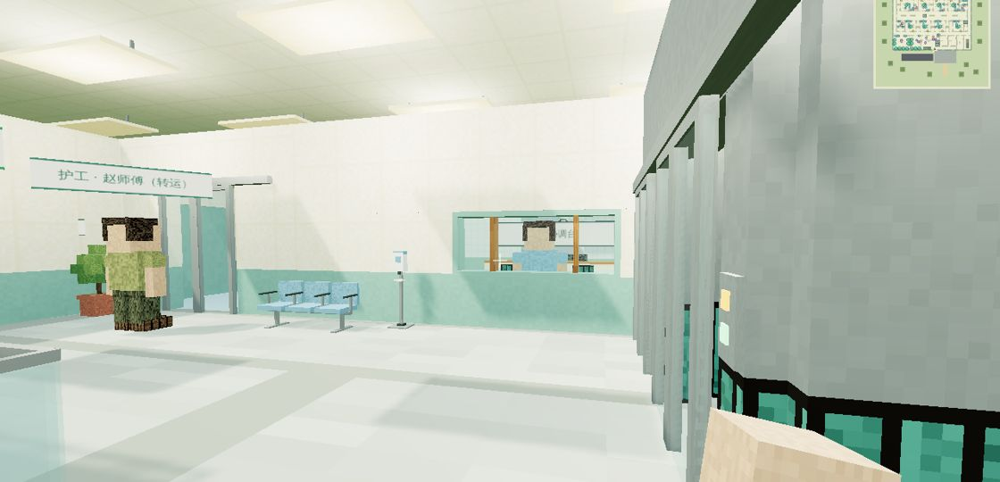 Operating department lobby · 手术部入口厅 |
| 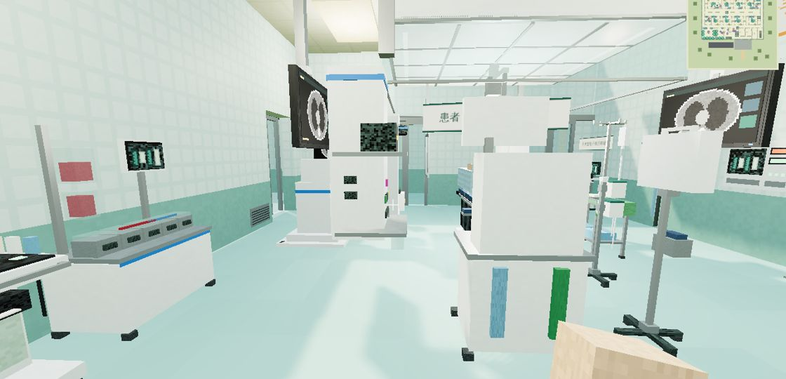 OR 1 · hybrid · 复合手术室 | 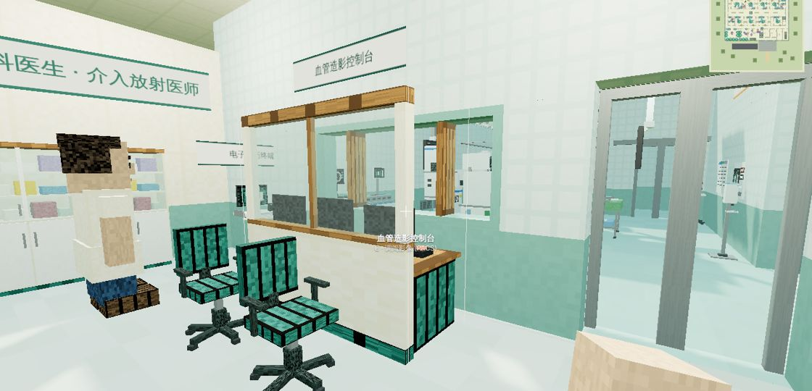 Hybrid control room · 控制室 |
| 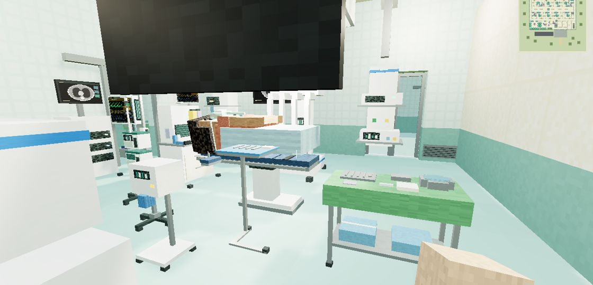 OR 2 · robotic · 机器人手术室 | 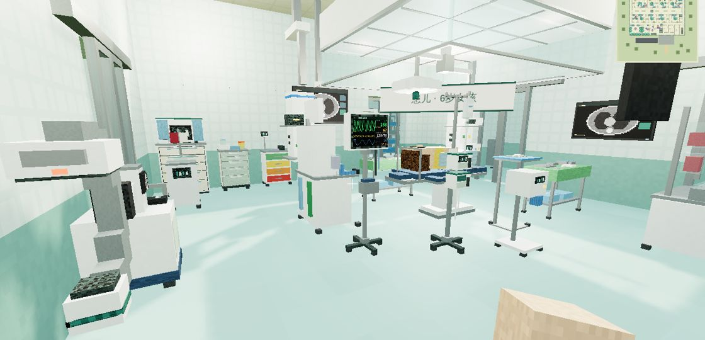 OR 3 · ultra-clean · 超净层流手术室 |
| 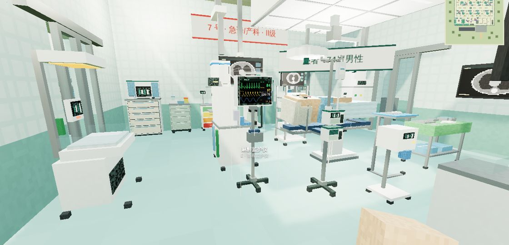 OR 7 · emergency & obstetric · 急诊/产科 | 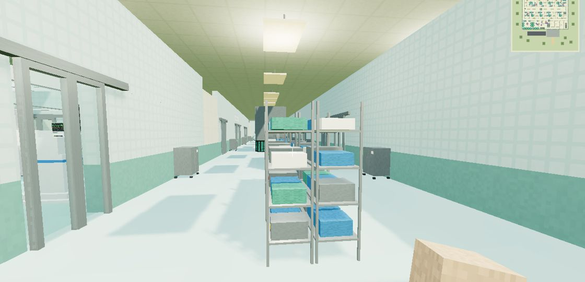 Sterile core · 无菌核心区 |
| 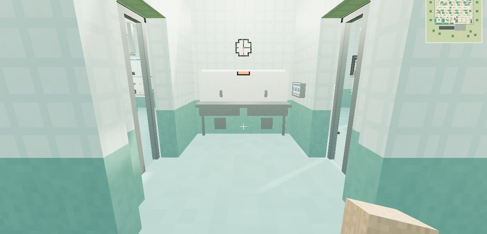 Scrub bay · 刷手间 | 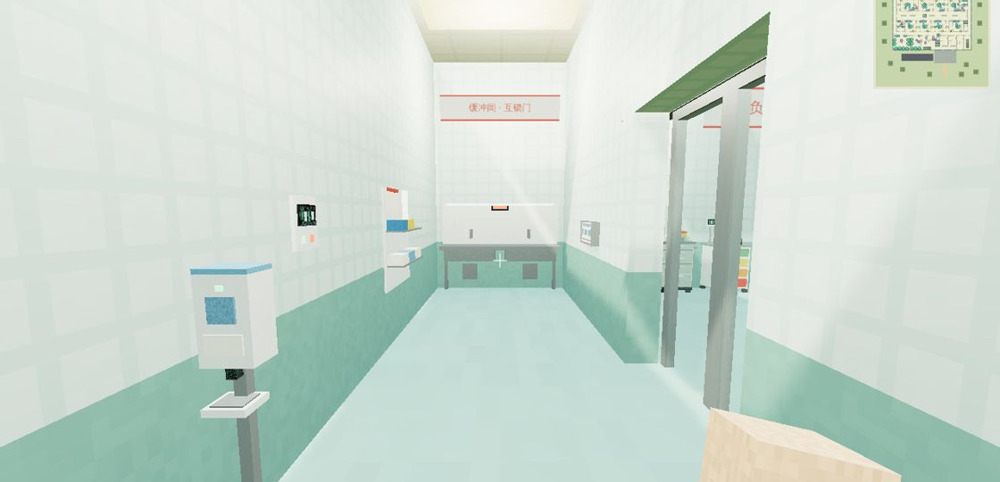 Isolation anteroom · 缓冲间 |
| 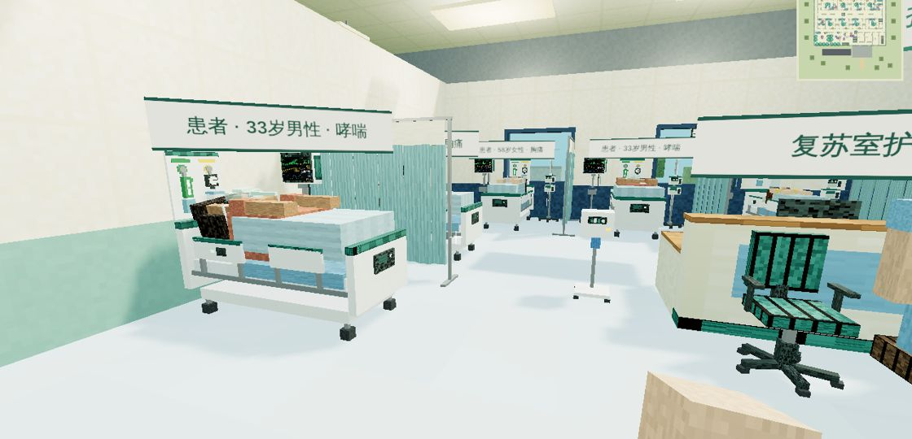 PACU · 麻醉后恢复室 | 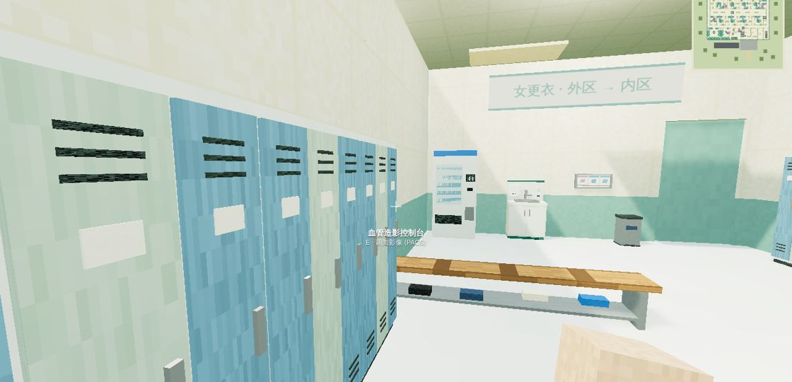 Staff changing · 更衣室 |
| 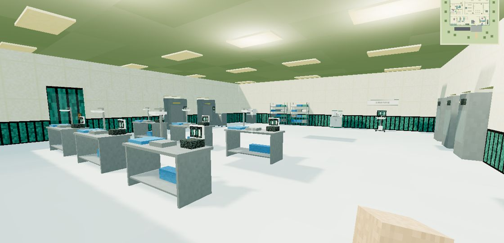 CSSD packing & sterilising · 消毒供应中心 | 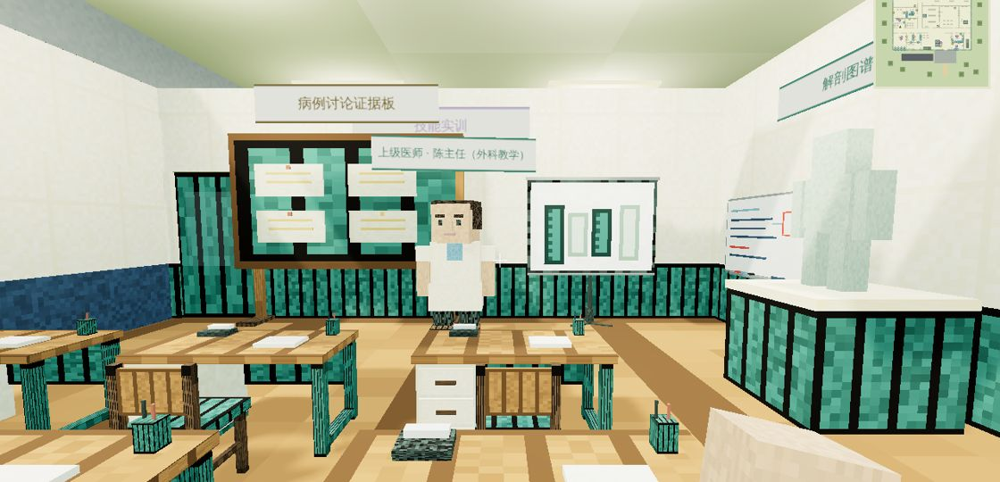 Skills lab · 技能实训室 |
| 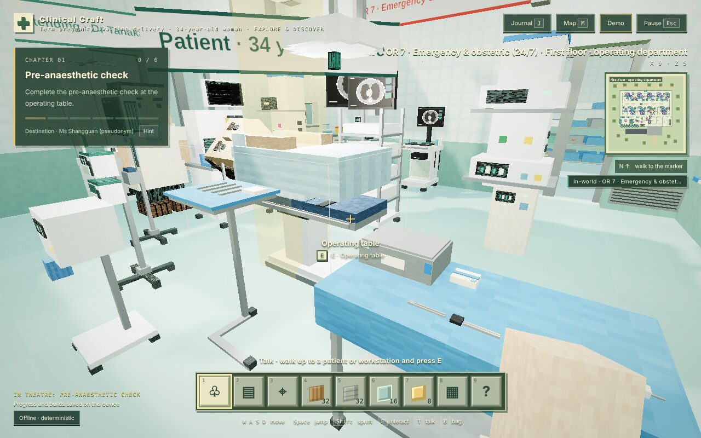 OR 7's set-up table after Nurse Lim passed the needle holder · 器械台 |  In your hands: two instruments, gown and gloves worn · 手中物品 |
| 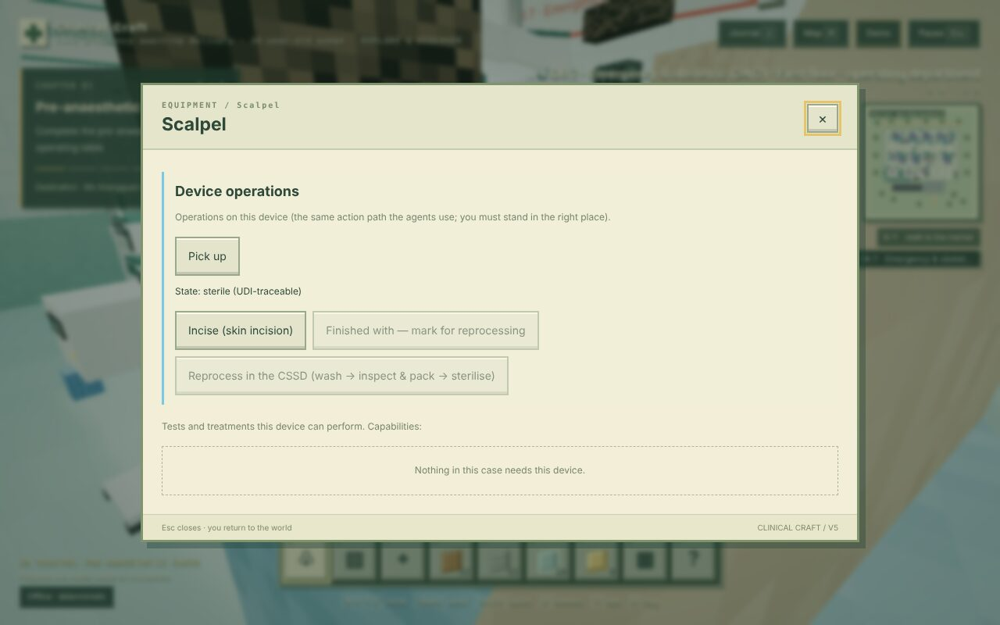 The safety scalpel: lifecycle, UDI, Pick up · 安全手术刀 | 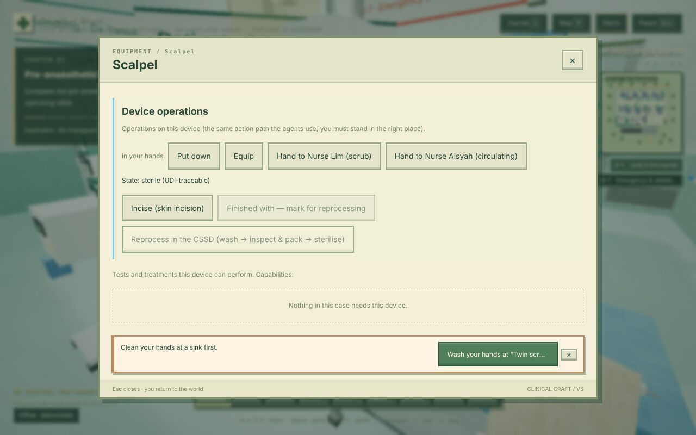 Incision refused until hand hygiene, with the way to the scrub trough · 拒绝并指路 |

## Sources

Standards themselves were not consulted in full text; the figures were checked against these
references (several secondary — verify against the current editions):

* GB 50333-2013 technical indices (Class I zone values, velocity, temperature, humidity,
  pressure): [解读 (Zhihu)](https://zhuanlan.zhihu.com/p/622003481),
  [规范全文转载 (yuanlin8)](https://www.yuanlin8.com/guifan/jianzhu/04fda57d.html),
  [GB 50333-2013 (codeofchina)](https://codeofchina.com/standard/GB50333-2013.html)
* ASHRAE 170 OR air changes, pressure, temperature, humidity:
  [MEP Academy — how OR HVAC systems work](https://mepacademy.com/how-operating-room-hvac-systems-work/),
  [ACHC — patient comfort and safety in the air](https://achc.org/obs-patient-comfort-and-safety-can-be-found-in-the-air/)
* DIN 1946-4 class Ia / TAV: [reinraum.de](https://www.reinraum.de/en/news/how-much-din-en-iso-14644ff-is-currently-and-in-the-future-incorporated-into-an-operating-room-in-a-hospital-according-to-din-1946-part-4.html),
  [Normec — which OR belongs to which room class](https://healthcare.normecgroup.com/news/which-operating-room-belongs-to-which-room-class)
* HTM 03-01 ultra-clean ≤ 10 CFU/m³: [Halton Vita OR brochure](https://www.halton.com/app/uploads/2020/08/Halton_Vita_OR_brochure_en.pdf)
* HBN 26: [NHS England](https://england.nhs.uk/publication/facilities-for-surgical-procedures-in-acute-general-hospitals-hbn-26)
* OR size (FGI-based state rule): [Oregon OAR 333-535-0110](https://www.law.cornell.edu/regulations/oregon/Or-Admin-Code-SS-333-535-0110)
* Hybrid OR planning: [Getinge — floor-mounted imaging](https://planning.getinge.com/en/operating-rooms-overview/floor-mounted-imaging-system-2/),
  [Center for Health Design (Nollert & Wich 2009)](https://www.healthdesign.org/sites/default/files/article-pdfs/Nollert-Wich-2009-CHD-KPS_0.pdf)
* Lighting: [IEC 60601-2-41:2021](https://webstore.iec.ch/en/publication/62677),
  [Glamox — operating theatres (EN 12464-1)](https://www.glamox.com/en/pbs/application-guide/healthcare/operating-theatres/)
* Receptacles per OR: [EC&M — NEC 517.19](https://www.ecmweb.com/nec/no-room-error)
* Medical gases in ORs: [PM Engineer — medical gas, required vs desired](https://pmmag.com/articles/105836-medical-gas-whats-required-vs-whats-desired)
* Traffic zones and attire: [AORN Traffic guideline preview](https://webstore.ansi.org/preview-pages/AORN/preview_II-04_Traffic_2012.pdf)
