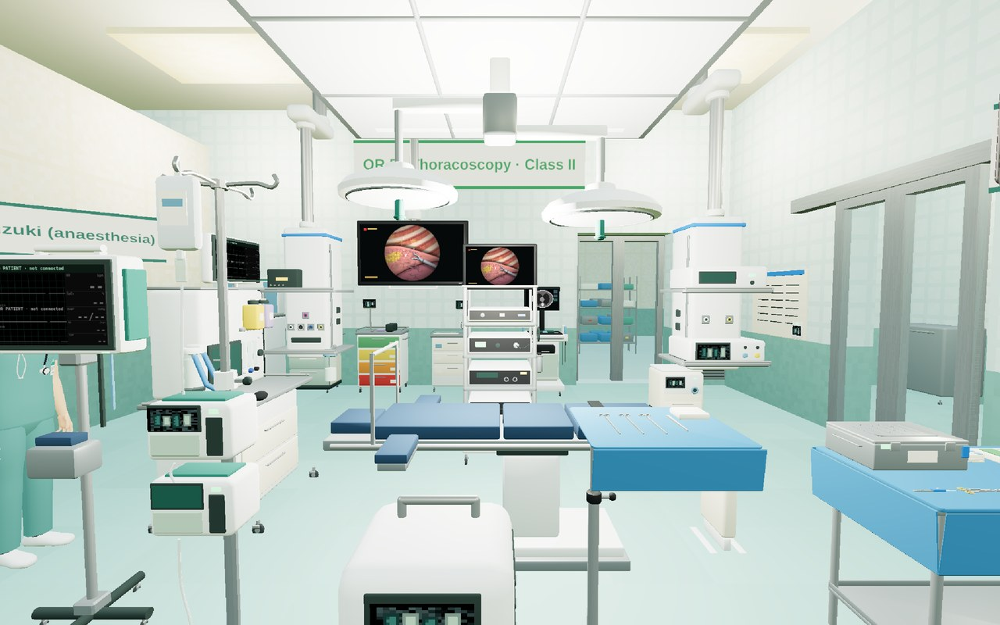
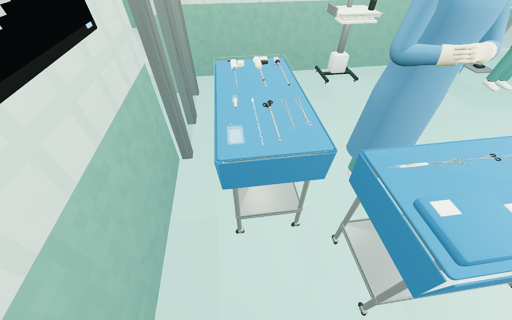
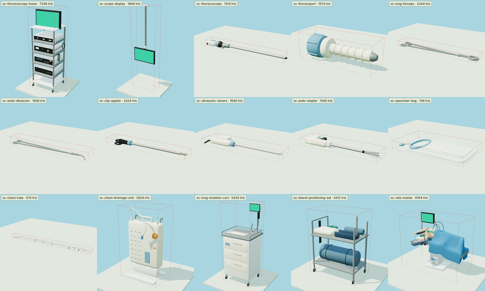
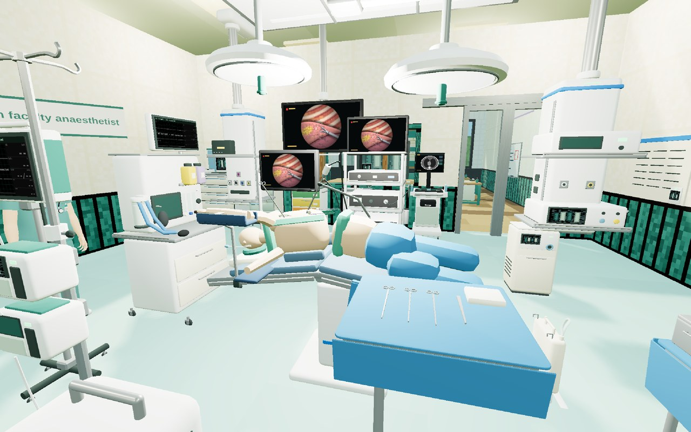
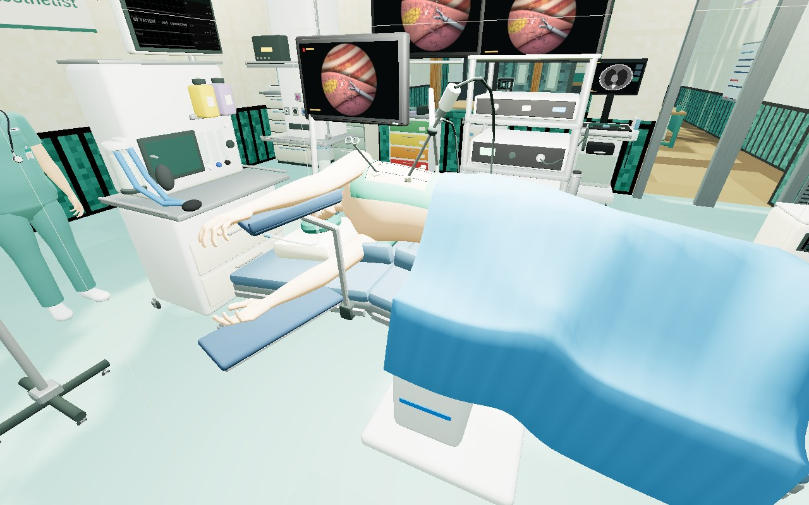
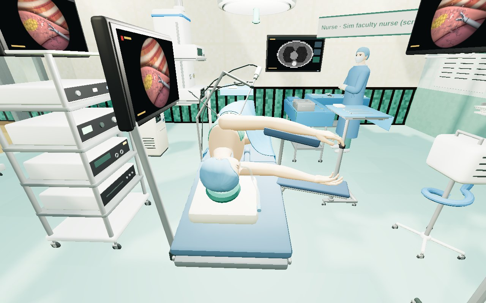
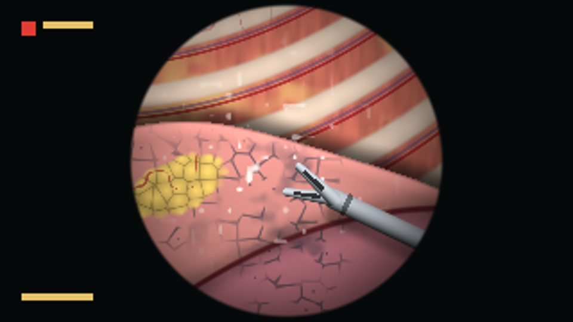

# Thoracoscopy · 胸腔镜手术

The IMPF Surgery Hospital now has what a thoracoscopic operation on the lung needs
(video-assisted thoracic surgery, VATS): **OR 5 is the thoracic theatre**, and in the simulation
centre a **training station** stands where the simulation OR's table would, on which the whole
sequence of a thoracoscopic lobectomy is rehearsed step by step. The monitors show the picture a
thoracoscope gives, which ClinicalCraft draws for them.

Like everything else in the pack it is data: fifteen equipment types with their models, a theatre
template, rules written as world predicates, one skill. A learner, an agent and a colleague act on
all of it through the same action bus.


*OR 5 from where the surgeon stands: the thoracoscopy tower across the table and the endoscopy
displays on their booms, all on one camera; lung isolation and the airway trolley at the far wall.*

## At a glance

| | |
|---|---|
| Theatre | OR 5 · Thoracic surgery (thoracoscopy), template `sc-or-thoracic`; the simulation OR on the ground floor is equipped the same way |
| Picture | thoracoscopy tower, two ceiling-boom endoscopy displays, the training station's own monitor: ClinicalCraft's `thoracoscopy` screen |
| Instruments | 30° thoracoscope, thoracic port, lung forceps, right-angle dissector, clip applier, ultrasonic shears, cutter-stapler, specimen bag, chest tube — nine handheld types on their own sterile table |
| Devices | lung-isolation cart (double-lumen tubes, bronchoscope), lateral-positioning aids, chest drainage unit |
| Training station | a torso in the lateral position with the three incisions of the standardized three-port anterior approach; 17 steps from the position check to the closure |
| Rules | the tube confirmed before turning and again after; no port before the time-out and the lung down; no picture before the white balance; energy with smoke evacuation; the drain primed, connected, and on its seal before the lung is re-expanded |
| Skill | `impf_thoracoscopy_setup`: tower on and white-balanced, smoke evacuator on, drainage unit primed |
| Checked by | `tools/thoracoscopy.test.ts` (7 tests), the gate and navigation tests, `tools/skills.test.ts` — all run by `tools/check.sh` |

## 中文概要

IMPF 外科医院新增了胸腔镜（VATS）肺手术所需的全部内容：**5 号手术间改为胸外科（胸腔镜）手术间**，一层
模拟手术室里原来放手术床的位置换成了**胸腔镜手术模拟训练台**，可以从核对体位到关胸，按顺序演练一台
胸腔镜下肺叶切除。手术间和训练台的显示器显示胸腔镜画面（由 ClinicalCraft 用代码绘制：胸膜下的肋骨与
肋间血管、带碳末沉着和叶间裂的萎陷肺、脂肪垫和一把肺钳）。

* **设备与器械（15 种，均有三维模型）**：4K 胸腔镜塔与吊臂内镜显示器；30° 胸腔镜、胸腔穿刺套管、肺钳、
  直角分离钳、施夹钳、超声刀、腔镜直线切割缝合器、标本袋、胸管（共 9 种手持器械，摆在单独的胸腔镜器械台
  上）；肺隔离用具车（双腔支气管导管与纤维支气管镜）、侧卧位体位用具车、胸腔闭式引流装置；模拟训练台。
* **规则（都是数据）**：导管位置确认后才能翻身，侧卧位核对完成后才能开始单肺通气；暂停核查完成且术侧肺
  萎陷后才能置入套管；白平衡后才能入镜；超声刀需要烟雾排除器运行；引流装置先注好水封才能置胸管，接上
  已置入的胸管后才能在直视下膨肺。
* **模拟训练台**：侧卧位躯干模型（左侧向上，折床、真空垫、腋下垫、托臂架），胸壁上是标准化三孔前入路的
  三个切口；17 个步骤，每一步都要手里拿着对应的器械，前提不满足时会说明还缺什么。
* 参考用的手术画面、器械和手术室图片只用于建模和绘制时对照，**没有任何一张收入本仓库**。
* 尚未包含胸腔镜手术的临床病例；引擎目前把卧位患者画成仰卧。详见[局限](#9-limits)。

## 1. Where it is

* **OR 5** (first floor, the west end of the south row) is the thoracic theatre. Its team is Nurse
  Wong (scrub), Nurse O'Connor (circulating) and Dr Suzuki (anaesthesia). General and colorectal
  minimally invasive surgery, which had OR 5, shares OR 6.
* **The simulation OR** (ground floor, surgical skills & simulation centre) is equipped as the
  thoracic theatre. It has no patient place; the training station stands where the table would.
* **OR 2** (robotic) is where robot-assisted thoracic surgery would be done; nothing was changed
  there.

## 2. The theatre

`sc-or-thoracic` is the integrated OR ([SURGICAL_FLOOR.md](SURGICAL_FLOOR.md) §3) with this
added or moved:

* the **thoracoscopy tower** beside the table, across the patient from the surgeon — camera
  control unit, LED light source, energy platform, recorder, a monitor; set up before the list
  (on and white-balanced);
* two **endoscopy displays** on ceiling booms, one facing each side of the table, so that
  whoever stands at the table looks at the picture straight ahead (the source for the approach
  below puts a monitor on each side of the table);
* a second **sterile table** set in an L with the first, laid with the thoracoscopy instruments;
  the scrub nurse stands in the corner between the two;
* the **lung-isolation cart** at the north wall towards the anaesthetic end, beside the
  difficult-airway trolley and the ultrasound machine (for nerve blocks and lines);
* the **lateral-positioning aids** on their trolley at the west wall;
* the **chest drainage unit** on the floor at the foot of the table.


*The scrub nurse between the two tables: on the left the thoracoscopy table — stapler,
ultrasonic shears and the thoracoscope along one side; lung forceps, dissector, clip applier,
chest tube, port and specimen bag along the other.*

## 3. Instruments and devices

Every type has a model built in Blender (`tools/blender/thoracic_models.py`;
[MODELS.md](MODELS.md)), a bilingual description and usage note, and — except the display — a
state machine.


*The fifteen new models as the world draws them (the green quads are where the live screens go).*

| type | states | operations (who) | needs |
|---|---|---|---|
| `sc-thoracoscopy-tower` · 4K 胸腔镜系统 | off → on → white-balanced | power on, white balance, power off (team) | — (off, it supplies no picture) |
| `sc-scope-display` · 吊臂式内镜显示器 | — | — | shows the camera's picture |
| `sc-thoracoscope` · 30° 胸腔镜 (10 mm) | sterile → in use → used → (CSSD) sterile | insert and look round (scrub team) | in hand, scrubbed, gowned and gloved, at the patient; **the tower white-balanced** |
| `sc-thoracoport` · 胸腔穿刺套管 (10.5 mm, blunt) | same | place the camera port (surgeon) | in hand, scrubbed …, at the patient; **the WHO time-out done; one-lung ventilation** |
| `sc-lung-forceps` · 腔镜肺钳 | same | hold the lung for exposure | in hand, scrubbed …, at the patient |
| `sc-endo-dissector` · 腔镜直角分离钳 | same | dissect a hilar structure and pass a loop (surgeon) | in hand, scrubbed …, at the patient |
| `sc-clip-applier` · 腔镜施夹钳 | same | clip a vessel branch (surgeon) | in hand, scrubbed …, at the patient |
| `sc-ultrasonic-shears` · 超声刀 (single use) | sterile → in use → discarded | cut / seal (surgeon), discard | in hand, scrubbed …, at the patient; **the tower on; the smoke evacuator running** |
| `sc-endo-stapler` · 腔镜直线切割缝合器 (single use) | sterile → reload in → fired → discarded | load a reload (scrub team), fire (surgeon), discard | load: in hand, scrubbed …; fire: also at the patient — **one firing for each reload** |
| `sc-specimen-bag` · 标本袋 (single use) | sterile → used | bag the specimen and bring it out (surgeon) | in hand, scrubbed …, at the patient |
| `sc-chest-tube` · 胸腔引流管 (28 Fr, single use) | sterile → placed | place through the camera port (surgeon) | in hand, scrubbed …, at the patient; **the drainage unit primed** |
| `sc-chest-drainage-unit` · 胸腔闭式引流装置 | in its pack → primed → on water seal ↔ on suction → used | prime, connect, apply suction, back to water seal, dispose (team) | connect: **a chest tube that is placed** |
| `sc-lung-isolation-cart` · 肺隔离用具车 | both lungs → tube placed → position confirmed → one lung → re-expanded | place the tube, confirm with the bronchoscope, isolate, re-expand (anaesthetist) | all at the patient's head; isolate: **the position check done**; re-expand: **the drain on its seal** |
| `sc-lateral-positioning-set` · 侧卧位体位用具车 | stowed → turned → table flexed → checked | turn, flex the table, check the position, turn back supine (team) | at the patient; turn: **the tube's position confirmed** |
| `sc-vats-trainer` · 胸腔镜手术模拟训练台 | 18 states, §6 | 17 steps and a reset | §6 |

## 4. The rules

Each is a precondition on an operation (`requires`), so a refusal is the world's own sentence
with the way to what is missing — *"Place the camera port needs the nearby "Lung-isolation cart
(double-lumen tubes & flexible bronchoscope)" to be on one-lung ventilation (the operated lung
down) (it is on both lungs)."* — and the route to the cart.

1. **The airway before the turn, and again after.** The patient is turned only once the
   double-lumen tube's position has been confirmed with the bronchoscope; one-lung ventilation
   starts only when the patient is on their side, the table flexed and the position checked —
   the tube is looked at again, because it moves when a patient is moved.
2. **No port into an inflated lung, and none before the time-out.** The camera port needs the
   WHO time-out (which needs the baseline count) and one-lung ventilation, besides hand hygiene,
   gown and gloves.
3. **No picture, no scope.** The thoracoscope goes in only with the tower on and white-balanced.
4. **Energy needs smoke evacuation** — the rule the electrosurgical pencil already has
   ([INTERACTIONS.md](INTERACTIONS.md)), here for the ultrasonic shears.
5. **A stapler fires once per reload.** It is loaded before it fires, and a fired stapler takes
   a fresh reload before it fires again.
6. **The drain.** The drainage unit is primed before the tube goes in; it is connected only to a
   tube that is in; the lung is re-expanded only with the drain on its water seal.
7. **The counts** close the operation as they close every other
   ([INTERACTIONS.md](INTERACTIONS.md)); the training station asks for the count before closing.

`tools/orflow.test.ts` checks, as for every theatre, that each of these gates is met only by its
own room's device and never through a wall.

## 5. An operation, start to finish

In OR 5, with a patient on the table (the rules need one):

1. **Set the room up** — tower on and white-balanced, smoke evacuator on, drainage unit primed:
   by hand, or as the skill `impf_thoracoscopy_setup`.
2. WHO **Sign in**. The anaesthetist **places the double-lumen tube** and **confirms its
   position** with the bronchoscope.
3. The team **turns the patient** onto their side, **flexes the table** and **checks the
   position**; the anaesthetist confirms the tube again and **isolates the lung**.
4. Scrub, gown and gloves; the **baseline count**; **Time out**.
5. "Port." — the **camera port**; the **thoracoscope** in; the working incisions under vision.
6. The operation: lung forceps, dissector, shears, clips and stapler, each in the hand that uses
   it; the **specimen** out in its bag.
7. The **chest tube** through the camera port, the unit **connected**; the anaesthetist
   **re-expands the lung** under vision.
8. Counts, closure, **Sign out**; the patient **turned back supine**; instruments to the CSSD.

## 6. The training station


*The simulation OR: the training station with its own monitor, the tower behind it and the
boom display above, all showing the camera's picture; in front, the Mayo stand.*

The station is a simulator, not a patient: a torso on its right side (left side up) on a
flexed table and a vacuum mattress, the head on a ring and a pillow so that the neck lies in
line, the lower arm out on a board, the upper arm forward on its padded support, hips and legs
under the drape with the lower leg bent. On the bare side of the chest, inside four towels, are
the three axillary lines in a skin marker's violet and the three incisions of the standardized
three-port anterior approach of Hansen and Petersen:

* the **utility incision**, about 5 cm, in the 4th intercostal space just in front of
  latissimus dorsi — a wound protector in it, the ribs not spread, a lung forceps through it;
* the **camera port**, 1 cm, low and anterior at about the level of the top of the diaphragm —
  the 10 mm 30° thoracoscope stands in it on a holder;
* the **third port**, 1.5 cm, at the same level further back, straight down from the scapula.


*The field from the surgeon's side: the lung forceps through the utility incision, the scope in
the low anterior port on its holder, the third port behind; the monitor shows what the scope
sees.*


*From the anaesthetic end: the head on its ring with the double-lumen tube, the lower arm on a
board, the upper arm on the padded support, the table flexed under the trunk.*

Its steps are those of a lower lobectomy in that approach — the vein, the artery, the bronchus
— and each is offered only after the one before. A step that needs an instrument is refused
until that instrument is in the hand, and says so.

| # | step | in the hand · in the room | what it rehearses |
|---|---|---|---|
| 1 | Check the position | — | operated side up, the axillary roll below the armpit, the arms forward, the table flexed to widen the intercostal spaces, pressure points padded |
| 2 | Let the lung down (simulated anaesthesia) | — | the tube confirmed again with the bronchoscope now that the torso is on its side, then one-lung ventilation |
| 3 | Camera port | thoracic port | low and anterior; in over the upper border of the lower rib, because the vessels and the nerve run in the groove under the rib above; a finger sweep before the port |
| 4 | Scope in, look round | thoracoscope · tower white-balanced | pleura, lung, diaphragm, mediastinum: adhesions, fluid, anything unexpected |
| 5 | Working incisions | — | the utility incision and the third port, each watched from inside as it comes through |
| 6 | Free adhesions, divide the pulmonary ligament | ultrasonic shears · smoke evacuator running | the lung made mobile |
| 7 | Dissect the hilum | right-angle dissector | the vein, the arterial branches and the bronchus freed and a loop passed round each |
| 8 | Divide the inferior pulmonary vein | stapler | a vascular reload; only the vein in the jaws, the tip clear beyond it |
| 9 | Divide the arterial branches | stapler, or the clip applier | vascular reloads; clips for small branches |
| 10 | Divide the lower lobe bronchus | stapler | the stapler closed where it is to fire, the lung inflated to see that the lobe that stays ventilates, then fired |
| 11 | Complete the fissure | stapler | the lobe free |
| 12 | Specimen out | specimen bag | bagged inside the chest and out through the utility incision, so that no tumour cells are left in the wound |
| 13 | Take the lymph nodes | ultrasonic shears · smoke evacuator running | hilar and mediastinal nodes |
| 14 | Test under water | — | the stump covered with warm saline, the lung inflated to a sustained 20–30 cmH₂O: no bubbles |
| 15 | Chest tube | chest tube · drainage unit primed | one tube through the camera port, its position confirmed under vision |
| 16 | Re-expand the lung (simulated anaesthesia) | — | slowly, under vision, every lobe seen to come up |
| 17 | Close | · the count before closing done | the count first, then the layers |

The order of the hilar steps is the source's for a lower lobe; it is different for the other
lobes (right upper: vein, anterior trunk, the remaining arteries, bronchus; middle: vein,
bronchus, artery; left upper: vein, first artery, bronchus, the remaining arteries), and other
approaches take the artery or the fissure first. Whether the lung is always inflated before the
bronchus is fired differs between surgeons; the station rehearses the cautious habit. The
station rehearses a sequence and its safety points — it has no anatomy to injure and no tissue
to feel.

The structures its steps name — fissure, vein, artery, bronchus, lymph nodes — are also the
phase names of a public video dataset of thoracoscopic lung resection
([DATASETS.md](DATASETS.md)).

## 7. The picture



ClinicalCraft draws it in code (its `packages/web/src/world/scope-picture.ts`): the round field
of a rigid scope on a dark monitor — the chest wall over the top, with ribs under the pleura and
a vein and an artery in the groove under each; the collapsed lung below, its lobules outlined
here and there in carbon pigment, a fissure between two lobes; a pad of fat; a steel grasper
coming in from a port; the light falling off to the rim.

It is **one representative frame**, as the slice on a PACS display is: it shows what the
equipment is for. It is not a patient's finding and it does not change with the steps.

## 8. What the reference pictures were used for

The work started from thirty-six reference pictures of thoracoscopic surgery: frames from
inside the chest (the chest wall and its vessels, the lung with its pigment and fissures,
adhesions being freed, hilar dissection, clips, staplers firing, a swab, blood being cleared),
an operating theatre with the team facing boom-mounted monitors, a patient prepared in the
lateral position and a drawing of that position, a thoracoscope in the hand and an instrument
table, a port and a chest tube seen from inside, drawings of a robotic set-up and of a rib
resection.

They were used the way a modeller uses photographs: to know what a thoracoscope, a short
thoracic port, ring forceps and a stapler's jaws look like, how a theatre is laid out round a
patient on their side, and what the scope shows. Every model and the picture were then made
from scratch, in code. **None of the reference pictures is in this repository**, and nothing
here reproduces one.

Three things they show are named here but not built:

* **robot-assisted thoracic surgery** — the hospital has a robotic theatre (OR 2); no thoracic
  rules were added to it;
* **thoracoscopic first rib resection** for thoracic outlet syndrome, an operation of its own;
* **thoracoscopic evacuation of a retained haemothorax**, which a trauma guideline recommends
  early (within about four days) in preference to thrombolytics.

## 9. Limits

* **No clinical case yet.** No case in the pack is a thoracoscopic operation, so in a session no
  patient lies in OR 5. Its rules are checked with the built-in operating-room case's patient
  placed on its table. The pack's `dataset/` holds published reports that could become such a
  case (a thoracoscopic segmentectomy, a wedge resection, a uniportal operation); each would
  have to be authored and grounded like Case 126.
* **The patient is drawn supine.** ClinicalCraft draws anyone lying down on their back. The
  lateral position is a state of the positioning aids; it is seen as a body only on the
  training station.
* **No operative field for the chest.** The operable anatomy of Case 126
  ([CASE_126.md](CASE_126.md)) is ClinicalCraft's procedure model, whose instruments, gas and
  injuries are those of a laparoscopic cholecystectomy. A lung, a bronchus and a stapler in that
  model would be engine work.
* **One frame on the monitors**, the same everywhere; it does not follow the tower's state.
* **A traditional drainage unit.** The unit modelled is a three-chamber water-seal unit; the
  guideline cited below recommends digital drainage systems and no routine external suction.
* **Not clinician-reviewed.** The texts follow the sources below; they are teaching content
  for a simulation, not a protocol.

## 10. Checks

```bash
tools/check.sh ../ClinicalCraft
```

* `tools/thoracoscopy.test.ts` — the theatre is set up (tower white-balanced, nine instruments
  laid out, three screens on the camera); the tube before the turn and one lung after the
  position check; the port after the time-out and the lung down, the scope after the white
  balance; energy with smoke evacuation and one firing per reload; the drain primed, connected
  and on its seal before re-expansion; the station where the table would stand; the whole
  sequence on the station with every refusal along the way.
* `tools/orflow.test.ts` — every gate in OR 5 and the simulation OR is met only by its own
  room's device; `tools/navcheck.test.ts` — everything interactive can be reached.
* `tools/skills.test.ts` — `impf_thoracoscopy_setup` in OR 5 and in the simulation OR, and
  never in the theatre next door.
* every model against its catalog reference (licence, hash, size against the footprint).

## Sources

Checked on 2026-11-11; the three marked † were read as abstracts only, and the two under ‡ as a
search engine quoted them (their pages could not be opened from here).

* Approach, ports, team and monitors, thoracoscope, order of division, the test before firing
  on the bronchus, stapler reloads, drain through the camera port: Hansen HJ, Petersen RH.
  Video-assisted thoracoscopic lobectomy using a standardized three-port anterior approach —
  the Copenhagen experience. *Ann Cardiothorac Surg* 2012;1(1):70–76.
  <https://pmc.ncbi.nlm.nih.gov/articles/PMC3741716/>
* Other approaches (posterior; uniportal, one incision of about 4–5 cm in the 5th intercostal
  space): Richards JMJ et al. *Ann Cardiothorac Surg* 2012;1(1):61–69,
  <https://pmc.ncbi.nlm.nih.gov/articles/PMC3741709/>; Gonzalez-Rivas D et al. *J Thorac Dis*
  2013;5(Suppl 3):S234–S245, <https://pmc.ncbi.nlm.nih.gov/articles/PMC3771611/>; Sihoe ADL.
  *Ann Cardiothorac Surg* 2016;5(2):133–144, <https://pmc.ncbi.nlm.nih.gov/articles/PMC4827405/>.
  Stapler reloads also: Kim K. *Korean J Thorac Cardiovasc Surg* 2011;44(1):1–8,
  <https://pmc.ncbi.nlm.nih.gov/articles/PMC3249267/>.
* Lateral position (axillary roll below the axilla to protect the brachial plexus and axillary
  vessels, arms forward and abducted no more than 90°, neck neutral, the lower leg flexed and
  the knees padded; table flexed; vacuum mattress): Armstrong M, Moore RA. Anatomy, Patient
  Positioning. StatPearls, <https://www.ncbi.nlm.nih.gov/books/NBK513320/>; Klapper J.
  Thoracotomy. TSRA Primer, <https://www.aats.org/tsra-primer-thoracotomy>. Where the table is
  flexed differs between authors.
* Double-lumen tubes (a left-sided tube usual; blue bronchial cuff and pilot balloon; the cuff
  just visible, not herniating over the carina; placement checked again after any change of
  position): Bora V et al. Double-Lumen Endobronchial Tubes. StatPearls,
  <https://www.ncbi.nlm.nih.gov/books/NBK535366/>.
* The intercostal vessels and nerve in the groove under each rib, vein uppermost, and going in
  over the upper border of the lower rib: Boaz NT et al. Anatomy, Thoracotomy and the Collateral
  Intercostal Neurovascular Bundle. StatPearls, <https://www.ncbi.nlm.nih.gov/books/NBK544368/>.
* Test under water (a sustained 20–30 cmH₂O): Lee YY et al. *J Clin Med* 2019;8(12):2092,
  <https://pmc.ncbi.nlm.nih.gov/articles/PMC6947439/>.
* Chest drainage after lung surgery (one tube, no routine external suction, digital systems):
  Batchelor TJP et al. Guidelines for enhanced recovery after lung surgery: recommendations of
  the ERAS Society and the ESTS. *Eur J Cardiothorac Surg* 2019;55:91–115,
  <https://www.ests.org/_userfiles/pages/files/ezy301.pdf>.
* ‡ The drainage unit itself — the water seal
  filled to its line (2 cm of water in most units), the swing of the column, bubbling as an air
  leak, the unit kept below the chest: the makers' instructions (for one: Teleflex, Pleur-evac
  set-up poster,
  <https://teleflex.com/usa/en/product-areas/surgical/educational-portal/pleur-evac/MC-000097Rev1_Pleurevac_RainSeries_Poster_ACTO.pdf>)
  and Doyle GR, McCutcheon JA. Clinical Procedures for Safer Patient Care, 10.7 Chest Drainage
  Systems (BCcampus), <https://opentextbc.ca/clinicalskills/chapter/10-7-chest-drainage-systems>.
* † Thoracoscopic first rib resection: George RS et al. *Ann Thorac Surg* 2017;103:241–245,
  <https://pubmed.ncbi.nlm.nih.gov/27659601/>.
* † Retained haemothorax: Patel NJ et al. Management of simple and retained hemothorax: a
  practice management guideline from the Eastern Association for the Surgery of Trauma.
  *Am J Surg* 2021;221:873–884, <https://pubmed.ncbi.nlm.nih.gov/33487403/>.
* † Low suction on digital drainage after VATS lobectomy: Holbek BL et al. *Eur J Cardiothorac
  Surg* 2019;55:673–681, <https://pubmed.ncbi.nlm.nih.gov/30445572/>.
